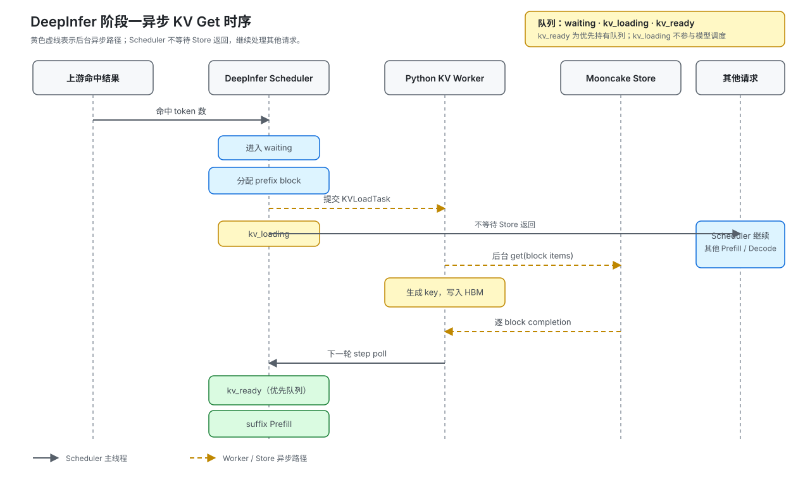
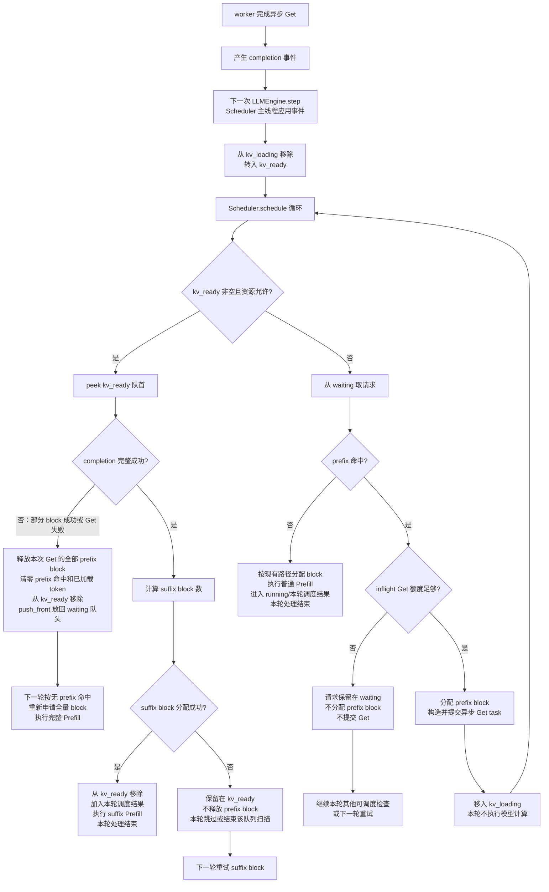
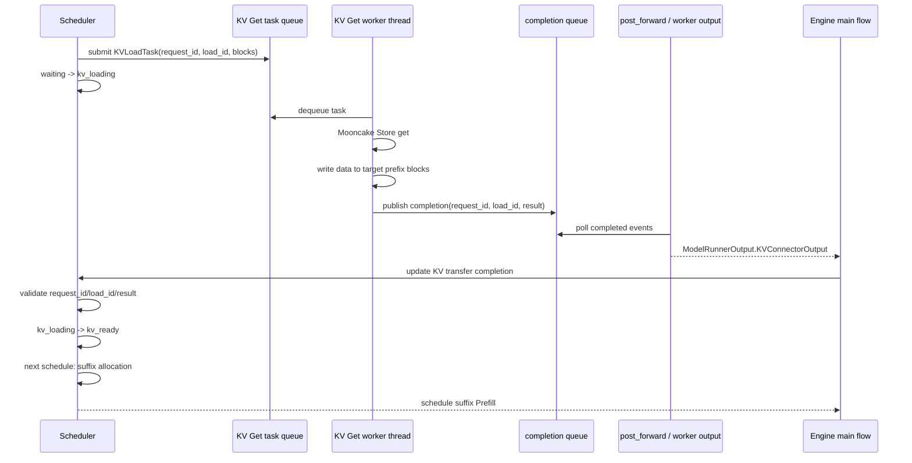
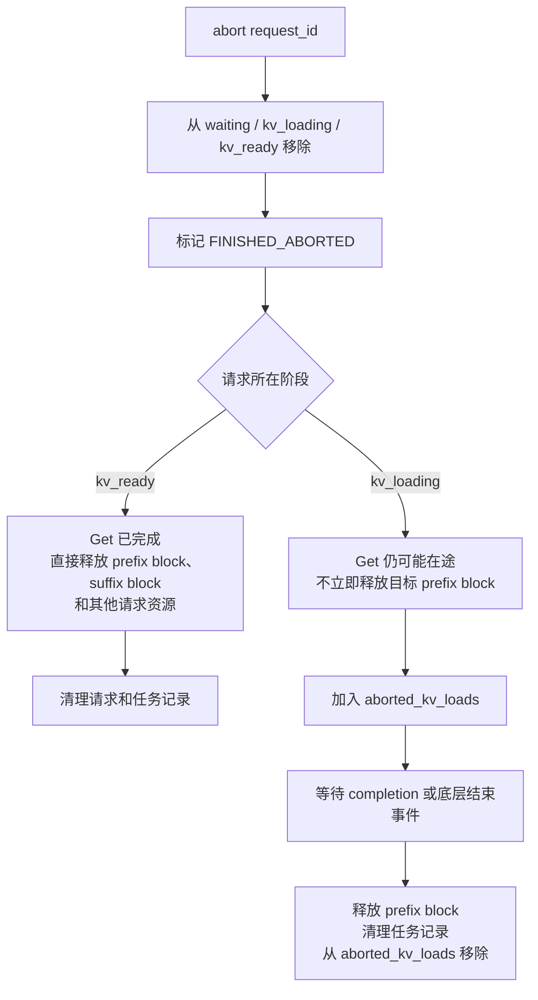

# REQ-KVP-04 PE 前缀命中块异步 KV Get 与调度交接

## 1. 引言

### 1.1 背景

当前 DeepInfer 的 `Scheduler` 以 `waiting`、`prompted` 和 `running` 管理请求。`DeepInfer/csrc/engine/scheduler.hpp` 中 `_schedule_prefill()` 遇到队首不可调度请求会停止扫描，`_has_prefill_waiting()` 也只检查队首。直接把 Store `get` 未完成的请求留在队首，会阻塞后续请求。

vLLM 的远端 KV 流程将“外部 block 分配、异步加载、完成确认、恢复 Prefill”分成不同阶段；vllm-ascend 的 worker 在 Python 侧执行异步 Store 操作。本需求沿用该生命周期，并适配 DeepInfer 的 C++ Scheduler 和 Python `LLMEngine.step()` 边界。

### 1.2 目标与范围

- 支持根据上游提供的命中 token 数异步拉取 prefix block。
- 拉取期间继续调度其他可执行请求。
- Store 完成后安全地恢复请求，并只计算未命中的 suffix。
- 在 Store miss、短读、取消、超时和资源不足时释放或保留正确的 HBM block。

## 2. 设计说明

### 2.1 总体流程



流程顺序如下：

1. 上游在 `add_sequence()` 前完成前缀匹配，向 DeepInfer 传入命中 token 数。
2. `Scheduler` 将请求放入 `waiting`，只保存命中结果，不提前占用 HBM。
3. 调度接纳时校验命中结果并分配 prefix block，生成 `KVLoadTask`，请求转入 `kv_loading`。
4. Python worker 依据请求 token、实际 block size、布局版本和 rank 拓扑生成 key，将每个 block 作为一个 Store item 提交到后台线程。
5. Store 直接向已注册的 `gpu_blocks` HBM segment 写入数据。
6. 下一轮 `LLMEngine.step()` 发起 completion poll，Scheduler 主线程校验 `load_id`、请求状态的结果。
7. 成功请求进入优先处理的 `kv_ready` 队列；suffix block 分配成功后直接进入当前或下一轮 Prefill。
8. 失败请求按连续有效前缀截短，或整体按 miss 重新 Prefill；后台 Store 未完成前不得释放目标 block。

### 2.2 队列

本方案借鉴 vLLM Scheduler 的多流队列设计，参考
[vllm/v1/core/sched/scheduler.py](https://github.com/vllm-project/vllm/blob/main/vllm/v1/core/sched/scheduler.py)。
DeepInfer 保留现有 `waiting` 队列，并新增两个由 Scheduler 主线程维护的队列：

```text
waiting       新请求或尚未启动 KV Get 的请求
kv_loading    prefix block 已分配，Store Get 已提交但尚未完成
kv_ready      Store Get 已完成，等待应用 completion 和 suffix block 分配
```

`kv_loading` 不参与模型计算。后台 worker 只提交 Store Get 并产生完成事件，不直接修改上述队列；完成事件由下一次 `LLMEngine.step()` 在 Scheduler 主线程中应用，将请求从 `kv_loading` 转入 `kv_ready`。

每次 `Scheduler.schedule()` 在一个循环中按以下顺序选择请求：

1. 优先扫描 `kv_ready`：查看队首请求，先检查 completion 是否为完整成功；只有完整成功时才计算 suffix block 数并尝试分配。completion 已在请求进入 `kv_ready` 前由 Scheduler 主线程校验并应用。
2. 按本方案的失败策略，如果 completion 只有部分 block 成功，或请求级 Get 失败，则将本次异步加载视为整体无效：释放本次异步 Get 分配的全部 prefix block，清零 prefix 命中和已加载 token 状态，从 `kv_ready` 移除并使用 `push_front` 放回 `waiting` 队头；下一次调度按无 prefix 命中的普通路径重新申请全量 block 并执行完整 Prefill，不继续使用部分 prefix。vLLM 对逐 block `invalid_block_ids` 另有保留连续有效前缀的处理；本方案选择全量重算以简化 DeepInfer 的失败恢复路径。
3. completion 完整成功且 suffix block 分配成功时，从 `kv_ready` 移除请求，加入本轮调度结果并执行 suffix Prefill，该请求的本轮处理结束。
4. completion 完整成功但 suffix block 分配失败时，不移除请求，不释放已应用的 prefix block；本轮跳过或结束 `kv_ready` 扫描，下一轮只重试 suffix block 分配。
5. `kv_ready` 当前为空或本轮资源不允许继续处理时，处理 `waiting`：没有 prefix 命中则按现有路径执行普通 Prefill；有 prefix 命中则检查 inflight Get 额度，额度足够时分配 prefix block、生成并提交 Get task，再将请求移入 `kv_loading`；额度不足时保留在 `waiting`，不分配 prefix block，也不提交 Get。
6. `kv_loading` 中的请求不参与模型计算。Get 完成后由 Scheduler 主线程应用完成事件并转入 `kv_ready`，不得在 worker 线程直接操作 Scheduler 队列。

单轮队列选择和转换如下：



### 2.3 异步 Get 完成与 Scheduler 消费

异步 Get 的后台线程不直接修改请求状态，也不直接操作 Scheduler 队列。它只负责从线程任务队列取出 `KVLoadTask`，执行 Mooncake Store `get`，将数据写入预先分配的 prefix block，并记录该任务的完成结果。vLLM 的对应实现中，worker 线程将完成的请求 ID 放入线程安全的完成集合；DeepInfer 采用等价的完成事件队列，事件至少包含 `request_id`、`load_id`、成功/失败状态、已完成 block 信息和错误信息。

完成结果通过模型执行边界回到主流程，过程如下：

1. Scheduler 为命中请求分配 prefix block 并提交 `KVLoadTask`；任务进入 KV Get worker 的任务队列，请求进入 `kv_loading`。
2. KV Get worker 从任务队列取任务，执行 Mooncake Store `get`，将每个 block 写入对应的 GPU/HBM 地址；worker 只发布完成事件，不修改 `Request` 状态或 Scheduler 队列。
3. worker 完成任务后，将 `request_id`、`load_id` 和结果写入线程安全的 completion 队列。完成事件表示 KV 数据已经写入目标 block，不表示请求已经完成 Prefill 或生成。
4. `post_forward()` 或等价的 worker 输出阶段轮询 completion 队列，构造本轮的 KV connector 输出；输出中携带 `finished_recving`、失败请求和无效 block 等信息，并随 `ModelRunnerOutput` 返回主流程。
5. Engine 主流程把该输出交给 Scheduler 的 completion 更新入口。Scheduler 在主线程校验 `request_id`、`load_id`、请求状态和 block 结果，丢弃重复、过期或已取消请求的无效事件。
6. 校验成功时，Scheduler 标记 completion 已应用，更新已加载 prefix token/block 状态，从 `kv_loading` 移除请求并加入 `kv_ready`；请求在本次输出处理阶段不直接执行模型计算。
7. 下一次 `Scheduler.schedule()` 优先扫描 `kv_ready`，计算 suffix block 数并尝试分配。分配成功后移出 `kv_ready`，加入本轮调度结果并执行 suffix Prefill；分配失败则保留请求和 prefix block，等待下一轮重试。



因此，DeepInfer 的实现边界应保持为：后台线程负责传输和发布 completion，`LLMEngine.step()`/`post_forward()` 负责收集 completion，Scheduler 主线程负责状态和队列迁移。不能由 Get worker 线程直接把请求从 `kv_loading` 移到 `kv_ready`，也不能在线程中直接调用 Prefill。

### 2.4 Get 额度与取消处理

#### 2.4.1 Get 额度

Scheduler 使用 `max_num_inflight_kv_loads` 限制同时占用的异步 Get 额度。新请求只有在下面的数量之和小于该上限时，才可以分配 prefix block 并提交异步 Get：

```text
正在进行的 KV Load 数量
+ 已完成但 Scheduler 尚未处理的 KV Load 数量
+ 已取消但底层传输可能仍在途的 KV Load 数量
< max_num_inflight_kv_loads
```

其中，`aborted_kv_loads` 只记录已经取消、但底层 Get 尚未确认结束的请求或任务 ID。它们仍占用 Get 额度，直到 completion 到达或底层任务明确结束后才从集合移除并释放目标 block。

#### 2.4.2 取消和资源释放

取消请求时，Scheduler 主线程先从 `waiting`、`kv_loading` 和 `kv_ready` 中移除请求，再标记 `FINISHED_ABORTED`：



`kv_ready` 中的请求已经完成 Get，因此可以立即释放已加载的 prefix block；`kv_loading` 中的请求可能仍有后台线程向目标 block 写入，必须延迟释放，避免后台传输访问已被复用的 block。

### 2.5 失败、取消和资源不足

- **逐 block 失败**：按 block 顺序保留从第一个 block 开始的连续成功前缀；失败 block 及后续 block 释放并按 miss 计算。
- **只有请求级结果**：无法判断连续前缀时，整次按 miss 处理。
- **Store 连接异常**：由 Mooncake backend 的重连、重注册和熔断逻辑处理；Scheduler 只接收失败结果，不等待重连。

### 2.6 与现有 DeepInfer 入口的接入

当前入口为：

```text
LLMEngine.step()
    → Scheduler.schedule(sequence_metadata_pool)
    → post_schedule(scheduler_outputs)
    → execute_model_step()
    → process_outputs()
```

接入顺序为：

```text
LLMEngine.step()
    → KVPoolWorker.poll_completions()
    → Scheduler.schedule(sequence_metadata_pool)
    → KVPoolWorker.submit_get_tasks(scheduler_outputs.kv_load_tasks)
    → post_schedule(scheduler_outputs)
    → execute_model_step()
```

## 3. 实现边界

### 3.1 C++ Scheduler 与 Python worker

- C++ Scheduler 负责命中 block 的资源接纳、队列状态、`load_id`、完成事件和 block 生命周期。
- Python worker 负责生成 Store key、构造已注册 HBM segment、后台调用 Mooncake `get` 和投递完成事件。
- worker 不直接修改 `Sequence`、`block_table` 或 Scheduler 队列；所有状态变化在主调度线程应用。

### 3.2 队列优先级

调度优先级为 `kv_ready`、普通 `waiting`；`kv_loading` 不参与模型调度。`kv_ready` 等价于 vLLM 的 KV holding waiting，资源不足时保持队首，不追加到普通 waiting 队尾。

## 4. 关键流程伪代码

### 4.1 Scheduler

```text
class Scheduler:
    def apply_kv_completions(self, completions):
        # 由 LLMEngine.step() 调用；Scheduler 不主动调用 Python worker。
        for completion in completions:
            seq = self.find_sequence(completion.request_id)
            if seq is None or seq.kv_load_id != completion.kv_load_id:
                continue  # 旧事件或重复事件
            if seq.schedule.status == FINISHED_ABORTED:
                self.release_loaded_blocks(seq)
                self.kv_loading.remove(seq)
                continue

            valid_blocks = continuous_success_prefix(completion.block_results)
            if valid_blocks == 0:
                self.release_loaded_blocks(seq)
                seq.cache.num_tokens = 0
                seq.prefix_hit_tokens = 0
                seq.schedule.status = WAITING
                self.kv_loading.remove(seq)
                self.waiting.push_front(seq)  # 完整 miss 优先重新 Prefill
                continue

            self.truncate_loaded_blocks(seq, valid_blocks)
            seq.prefix_hit_tokens = valid_blocks * self.block_size
            seq.schedule.status = WAITING
            self.kv_loading.remove(seq)
            self.kv_ready.push_back(seq)  # 对应 vLLM kv_holding_waiting

    def admit_kv_loads(self, outputs):
        for seq in self.waiting:
            hit_tokens = seq.prefix_hit_tokens_from_upstream
            if hit_tokens == 0:
                continue
            if hit_tokens % self.block_size != 0:
                self.mark_prefix_miss(seq)
                continue

            block_count = hit_tokens // self.block_size
            if not self.block_manager.can_allocate_nolock(block_count):
                break  # 保持 waiting 队首语义

            local_blocks = self.block_manager.allocate_nolock(block_count)
            self.pin(local_blocks)
            seq.cache.block_table.assign(local_blocks)
            seq.cache.num_tokens = hit_tokens
            seq.prefix_hit_tokens = hit_tokens
            seq.kv_load_id = self.next_load_id()
            seq.schedule.status = WAITING_FOR_REMOTE_KVS
            self.kv_loading.push_back(self.waiting.pop_front())
            outputs.kv_load_tasks.push_back(self.make_task(seq, local_blocks))

    def schedule(self, sequence_metadata_pool):
        # vLLM 的 kv_holding_waiting 语义：ready 请求优先，资源不足时保持队首。
        while self.kv_ready:
            seq = self.kv_ready.front()
            suffix_blocks = self.required_suffix_blocks(seq)

            self.allocate_suffix_blocks(seq, suffix_blocks)
            self.kv_ready.pop_front()
            self.schedule_prefill(seq)

        outputs = SchedulerOutputsBuilder()
        self.admit_kv_loads(outputs)
        outputs.extend(self.schedule_normal_prefill_or_decode(sequence_metadata_pool))
        return outputs

    # `schedule_prefill` 继续复用现有 chunked-prefill 路径；若 suffix 未在一轮完成，
    # 请求按原有 chunk 状态在后续轮次继续执行，不重新提交 Store get。
```

### 4.2 KVPoolWorker

```text
class KVPoolWorker:
    def submit_get_tasks(self, tasks):
        for task in tasks:
            self.executor.submit(self._get_one_task, task)

    def _get_one_task(self, task):
        items = []
        for index, local_block_id in enumerate(task.local_block_ids):
            # key 在 PE 侧生成；C++ Scheduler 不保存完整 Store key。
            key = build_store_key(task.request_tokens, task.block_size,
                                  task.layout_version, self.rank_info, index)
            address = self.gpu_blocks.data_ptr() + local_block_id * task.block_bytes
            items.append(GetItem(key, [(address, task.block_bytes)]))

        # backend 负责短读、对象不存在、重连和熔断，并返回逐 item 结果。
        result = self.mooncake_store.get(items)
        self.completion_queue.put(
            KVLoadCompletion(task.request_id, task.kv_load_id, result)
        )

    def poll_completions(self):
        # 由 LLMEngine.step() 发起；这里只读取完成队列，不修改 Scheduler 状态。
        return self.completion_queue.drain()
```


## 5. ST 测试用例

测试用例只描述验证计划，不代表已经执行或通过。

| 用例编号     | 类型 | 测试目的                     | 测试步骤                                                                          | 测试点 / 预期结果                                                                          |
| ------------ | ---- | ---------------------------- | --------------------------------------------------------------------------------- | ------------------------------------------------------------------------------------------ |
| TC-KVP-04-01 | 正常 | 验证完整命中异步恢复         | 提交对齐的命中数；保持 Store 未完成；再返回全部 block 成功并执行下一轮 step       | get 期间其他请求继续调度；完成请求进入 `kv_ready` 优先队列并执行 suffix Prefill。        |
| TC-KVP-04-02 | 正常 | 验证无命中复用原有 Prefill   | 提交 `hit_tokens == 0` 的请求并执行调度                                         | 不分配 prefix block、不生成异步 task，直接走现有 Prefill。                                 |
| TC-KVP-04-03 | 并发 | 验证优先队列      | 让一个请求完成 get、另一个请求仍在 `kv_loading`，分别设置 suffix 资源足够和不足 | `kv_ready` 优先处理；资源不足时保持队首。 |
| TC-KVP-04-04 | 异常 | 验证部分失败和短读回退       | 多 block 请求中间 block 返回短读或失败                                            | 只保留连续有效前缀，后续 token 走普通 Prefill；不使用失败 block 后的数据。                 |
| TC-KVP-04-05 | 异常 | 验证整体 miss 与资源清理     | 让 Store 返回请求级失败或首 block 失败                                            | prefix block 释放且不重复释放，命中数清零，请求优先回到 waiting 重新计算。                 |
| TC-KVP-04-06 | 异常 | 验证取消、重复和过期完成事件 | get 在途时取消请求，再注入完成、重复完成和旧 `load_id` 事件                     | 事件被丢弃，block 只释放一次，不修改已取消或已完成请求。                                   |
