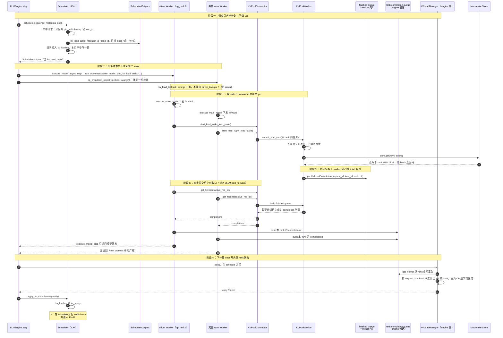
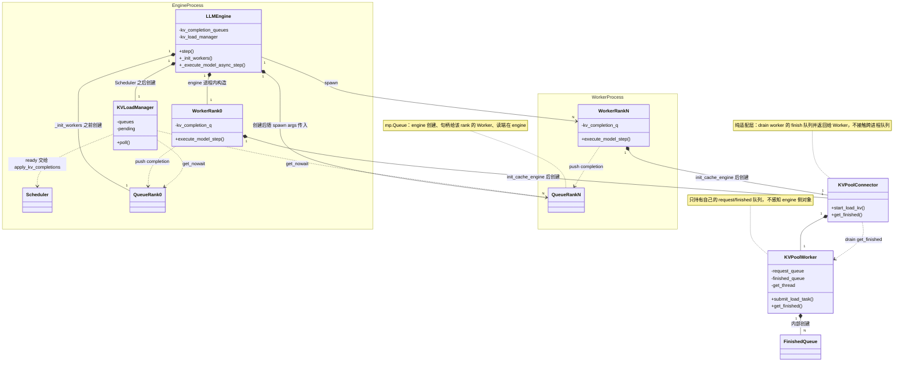
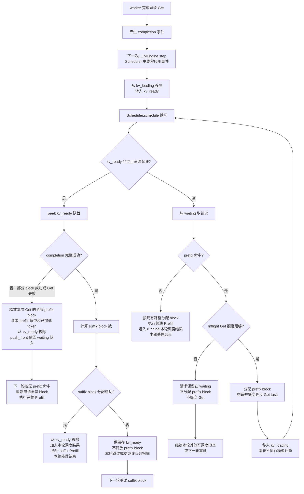
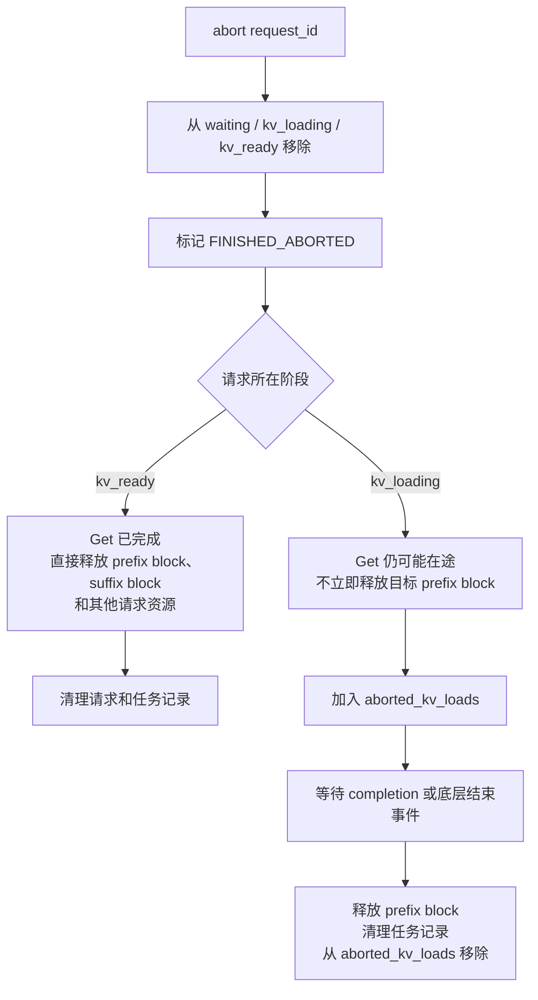
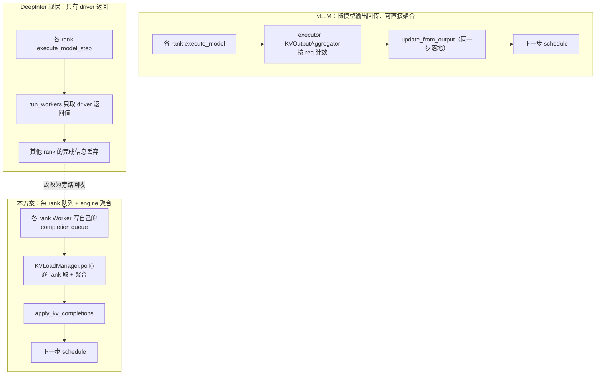

### 1. 关联需求 / Issue

REQ-KVP-04

### 2. 涉及模块

kv-cache-pooling

### 3. 背景与问题

当前 DeepInfer 的 `Scheduler` 以 `waiting`、`prompted` 和 `running` 管理请求。`DeepInfer/csrc/engine/scheduler.hpp` 中 `_schedule_prefill()` 遇到队首不可调度请求会停止扫描，`_has_prefill_waiting()` 也只检查队首。直接把 Store `get` 未完成的请求留在队首，会阻塞后续请求。

vLLM 的远端 KV 流程将“外部 block 分配、异步加载、完成确认、恢复 Prefill”分成不同阶段；vllm-ascend 的 worker 在 Python 侧执行异步 Store 操作。本需求沿用该生命周期，并适配 DeepInfer 的 C++ Scheduler 和 Python `LLMEngine.step()` 边界。

### 4. 目标与非目标

### 4.1 目标

- 支持按上游命中 token 数异步加载 prefix block。
- 加载期间继续调度其他可执行请求。
- Get 完成后只计算 suffix 并恢复 Prefill。
- 明确定义额度、取消、失败、重试和 block 生命周期。

### 4.2 非目标

- 不重新定义 REQ-KVP-02 的 hash/key 规则。
- 不替换 REQ-KVP-03 的 Store client。
- 不在本次方案引入 SWA 远端加载。

### 5. 设计方案

### 5.1 总体流程

本节只描述**异步 Get 任务的下发与完成回收**：Scheduler 内部如何选请求、如何算额度、失败后如何回退，都不在本节展开。

单步时序（对应 vLLM 的 `schedule → execute_model → post_forward → update_from_output` 主线）：



特殊或新增位置说明：

| #  | 位置                                      | 说明                                                                                                                                                                                                                                                                                        |
| -- | ----------------------------------------- | ------------------------------------------------------------------------------------------------------------------------------------------------------------------------------------------------------------------------------------------------------------------------------------------- |
| ① | `SchedulerOutputs.kv_load_tasks`        | 对应 vLLM 的 `SchedulerOutput.kv_connector_metadata`（`ReqMeta` 列表）。只描述任务，Scheduler 全程不碰 Store。                                                                                                                                                                          |
| ② | `execute_model_step(kv_load_tasks=...)` | 必须作为 `_run_workers()` 的普通 `kwargs` 下发（`worker/base.py:300` 广播），**不能放进 `driver_kwargs`**（`:302` 只给 driver）。`seq_metadata_list` / `scheduler_outputs` 是 pybind 对象不可序列化，才放 `driver_kwargs`。                                           |
| ③ | `start_load_kv()` 调用点                | 对齐 vLLM `post_forward()` 的提交点（`vllm/v1/worker/gpu/kv_connector.py:142-143`）：在每个 rank 的 `execute_model_step` 内、`execute_main_model` 之后（`deepinfer/worker/worker.py:121-127` 之后）。不能只在 driver 调，否则其他 rank 不会提交自己的分片。                       |
| ④ | `get_finished()` 调用点                 | 紧跟 ③（同一函数内、`worker.py:262-263` 的 `sample_end_evt.synchronize()` 之前）：本步提交后立刻 drain，**每个 rank 各调一次**。与 vLLM `post_forward()` 里"先 `start_load_kv`、再 `get_transfer_results`"（`kv_connector.py:142-148`）同构。                            |
| ⑤ | worker 内 finish 队列                     | 每个 `KVPoolWorker` 私有（每条 Get 线程一条），只被本 worker 的 Get 线程写、被 `get_finished()` 读，**不持有任何 engine 侧对象**。对应 vLLM `KVCacheStoreRecvingThread.finished_requests` + `set_finished_request()`（`mooncake/store/worker.py:1271-1291`、`:1488`）。   |
| ⑥ | rank completion queue                     | 每 rank 一条：rank0 是 engine 进程内 `queue.Queue`，其余 rank 是 engine 创建、spawn 时随 `args` 传入的 `mp.Queue`（`llm_engine.py:377-395`）。**写端是该 rank 的 `Worker`**（它持有本 rank 的队列句柄，`get_finished()` 拿到结果后由它 push），读端是 `KVLoadManager`。 |
| ⑦ | engine 侧聚合                             | `KVLoadManager.poll()` 取代 vLLM 的 `KVOutputAggregator`：key 为 `(request_id, load_id)`，期望集合是 CP 组（DeepInfer 无 TP/PP，DP 是独立引擎，各有一份调度器）。                                                                                                                     |
| ⑧ | poll 时机                                 | 在 `Scheduler.schedule()` **之前**（`llm_engine.py:885` 之前）。vLLM 的完成态在 `update_from_output()` 落地、下一轮 `schedule()` 才 promote；这里提前一个半拍，完成消息到达后同一步即可进入 suffix 调度。                                                                     |
| ⑨ | 每 rank 必须上报                          | 即使某 rank 的分片为空也要上报成功，否则计数永远凑不满 CP 组（与 vLLM `nixl/pull_worker.py:208` 同一约束）。                                                                                                                                                                              |
| ⑩ | 纯等待步                                  | 本步无其他请求时 `scheduler_outputs` 为空，`execute_model_step` 走 `is_placeholder` 的 dummy forward（`worker.py:126-127`）。`start_load_kv` / `get_finished` 必须在这个分支里也执行，否则 waiting 期的 Get 发不出去、完成也收不回来。                                          |

调用链分三层，任何一层都不反向持有外层对象：`KVPoolWorker` 只认自己的 finish 队列（可脱离 engine 单测）；`KVPoolConnector` 只做适配，drain 后把结果交回本 rank 的 `Worker`；**每个 rank 的 `Worker` 各写各的 completion queue**；`KVLoadManager` 只在 engine 侧做跨 rank 聚合。

### 5.2 新增组件、归属与初始化

§5.1 的时序引入 4 个新对象，按三层组织，任何一层都不反向持有外层对象：

| 组件                  | 归属 / 实例数                                                                                                                         | 运行位置                                                         | 职责                                                                                                    | 关键方法                                   |
| --------------------- | ------------------------------------------------------------------------------------------------------------------------------------- | ---------------------------------------------------------------- | ------------------------------------------------------------------------------------------------------- | ------------------------------------------ |
| `KVPoolWorker`      | 每 rank 1 个，由 `KVPoolConnector` 持有                                                                                             | driver（cp_rank 0）在 engine 进程内；其余 rank 在 spawn 子进程内 | 本地 request queue + 后台 Get 线程；`store.get` 直写本 rank HBM；完成写入**自己的 finish 队列** | `submit_load_task()`、`get_finished()` |
| worker 内 finish 队列 | 每个 `KVPoolWorker` 私有（每条 Get 线程一条）                                                                                       | 与该 rank 的 worker 同进程                                       | 线程安全完成集合，只有本 worker 的 Get 线程写、`get_finished()` 读                                    | `put()` / `drain()`                    |
| `KVPoolConnector`   | 每 rank 1 个，由该 rank 的 `Worker` 持有                                                                                            | 同上                                                             | 任务转换与提交；步内 drain worker 的 finish 队列并把结果**返回给 Worker**（不碰跨进程队列）       | `start_load_kv()`、`get_finished()`    |
| rank completion queue | **每 rank 1 条，实例由 `LLMEngine` 创建并持有**；句柄交给该 rank 的 `Worker`，写端就是 `Worker`，读端是 `KVLoadManager` | rank0 是进程内 `queue.Queue`；rank1..N-1 是跨进程 `mp.Queue` | 把"本 rank 已完成的 Get"送到 engine                                                                     | `put()` / `get_nowait()`               |
| `KVLoadManager`     | engine 侧唯一 1 个，由 `LLMEngine` 持有                                                                                             | engine 进程                                                      | 逐 rank 非阻塞取，按 `(request_id, load_id)` 聚合，凑满 CP 组后交给 Scheduler                         | `poll()`                                 |



初始化分两段，完整伪代码见 §6.6：

1. engine 进程在 `_init_workers()` 之前建好 `rank → completion queue`（rank0 进程内 `queue.Queue`，其余 `mp.Queue`），spawn 时随 `args` 传入；
2. `Scheduler` 创建之后建 `KVLoadManager`（注入 scheduler 与队列字典）；
3. 每个 rank 在 `init_cache_engine()` 之后建 `KVPoolConnector` / `KVPoolWorker` 并注册 HBM；
4. 每步 `execute_model_step` 内 `start_load_kv` → `get_finished` → 由该 rank 的 Worker 写自己的队列。

三条硬性顺序约束：

1. **队列必须先于 `_init_workers()`（`llm_engine.py:233`）创建**，否则 spawn 的子进程拿不到句柄。
2. **`KVLoadManager` 必须晚于 `Scheduler`（`llm_engine.py:267`）创建**，因为它要注入 Scheduler 并在 `poll()` 里回调应用完成事件；时机与多模态的 `multi_modal_processor.scheduler = self.scheduler`（`:269-270`）一致。
3. **worker 侧组件必须晚于 `init_cache_engine`（`base.py:270-272`）创建**：此时才有 `gpu_cache` 地址可注册给 Store，不要放在 `Worker.__init__` 里。

线程归属：Get 线程是每个 rank 进程内的 daemon 线程（每 rank 至少一条），只写本 worker 的 finish 队列；`execute_model_step` 里由 `KVPoolConnector.get_finished()` 同步 drain，**再由该 rank 的 `Worker` 写进自己的 completion queue**；engine 主线程只在 `KVLoadManager.poll()` 里读。driver 的 Get 线程与 engine 主线程同进程但不同线程，靠队列的线程安全保证读写。

### 5.3 调度器侧的异步 Get 调度流程

本节介绍 Scheduler 如何对带 prefix 命中的请求做异步 Get 调度：请求在 `waiting` / `kv_loading` / `kv_ready` 之间的流转，以及每轮 `schedule()` 的选择顺序。

本方案借鉴 vLLM Scheduler 的多流队列设计，参考
[vllm/v1/core/sched/scheduler.py](https://github.com/vllm-project/vllm/blob/main/vllm/v1/core/sched/scheduler.py)。
DeepInfer 保留现有 `waiting` 队列，并新增两个由 Scheduler 主线程维护的队列：

```text
waiting       新请求或尚未启动 KV Get 的请求
kv_loading    prefix block 已分配，Store Get 已提交但尚未完成
kv_ready      Store Get 已完成，等待应用 completion 和 suffix block 分配
```

`kv_loading` 不参与模型计算。后台 worker 只提交 Store Get 并产生完成事件，不直接修改上述队列；完成事件由下一次 `LLMEngine.step()` 在 Scheduler 主线程中应用，将请求从 `kv_loading` 转入 `kv_ready`。

每次 `Scheduler.schedule()` 在一个循环中按以下顺序选择请求：

1. 优先扫描 `kv_ready`：查看队首请求，先检查 completion 是否为完整成功；只有完整成功时才计算 suffix block 数并尝试分配。completion 已在请求进入 `kv_ready` 前由 Scheduler 主线程校验并应用。
2. 按本方案的失败策略，如果 completion 只有部分 block 成功，或请求级 Get 失败，则将本次异步加载视为整体无效：释放本次异步 Get 分配的全部 prefix block，清零 prefix 命中和已加载 token 状态，从 `kv_ready` 移除并使用 `push_front` 放回 `waiting` 队头；下一次调度按无 prefix 命中的普通路径重新申请全量 block 并执行完整 Prefill，不继续使用部分 prefix。vLLM 对逐 block `invalid_block_ids` 另有保留连续有效前缀的处理；本方案选择全量重算以简化 DeepInfer 的失败恢复路径。
3. completion 完整成功且 suffix block 分配成功时，从 `kv_ready` 移除请求，加入本轮调度结果并执行 suffix Prefill，该请求的本轮处理结束。
4. completion 完整成功但 suffix block 分配失败时，不移除请求，不释放已应用的 prefix block；本轮跳过或结束 `kv_ready` 扫描，下一轮只重试 suffix block 分配。
5. `kv_ready` 当前为空或本轮资源不允许继续处理时，处理 `waiting`：没有 prefix 命中则按现有路径执行普通 Prefill；有 prefix 命中则检查 inflight Get 额度，额度足够时分配 prefix block、生成并提交 Get task，再将请求移入 `kv_loading`；额度不足时保留在 `waiting`，不分配 prefix block，也不提交 Get。
6. `kv_loading` 中的请求不参与模型计算。Get 完成后由 Scheduler 主线程应用完成事件并转入 `kv_ready`，不得在 worker 线程直接操作 Scheduler 队列。

单轮队列选择和转换如下：



### 5.4 Get 额度与取消处理

#### 5.4.1 Get 额度

Scheduler 使用 `max_num_inflight_kv_loads` 限制同时占用的异步 Get 额度。新请求只有在下面的数量之和小于该上限时，才可以分配 prefix block 并提交异步 Get：

```text
正在进行的 KV Load 数量
+ 已完成但 Scheduler 尚未处理的 KV Load 数量
+ 已取消但底层传输可能仍在途的 KV Load 数量
< max_num_inflight_kv_loads
```

其中，`aborted_kv_loads` 只记录已经取消、但底层 Get 尚未确认结束的请求或任务 ID。它们仍占用 Get 额度，直到 completion 到达或底层任务明确结束后才从集合移除并释放目标 block。

#### 5.4.2 取消和资源释放

取消请求时，Scheduler 主线程先从 `waiting`、`kv_loading` 和 `kv_ready` 中移除请求，再标记 `FINISHED_ABORTED`：



`kv_ready` 中的请求已经完成 Get，因此可以立即释放已加载的 prefix block；`kv_loading` 中的请求可能仍有后台线程向目标 block 写入，必须延迟释放，避免后台传输访问已被复用的 block。

### 5.5 失败、取消和资源不足

- **部分 block 失败**：按本方案将本次异步加载整体视为失败，释放本次 Get 分配的全部 prefix block，清零命中状态，放回 `waiting` 队头并重新申请全量 block 执行 Prefill。
- **只有请求级结果**：无法判断逐 block 结果时，同样按整体 miss 处理。
- **Store 连接异常**：由 Mooncake backend 的重连、重注册和熔断逻辑处理；Scheduler 只接收失败结果，不等待重连。

### 5.6 与 vLLM 的差异：completion 为何要按 rank 回收

vLLM 的完成回收依赖"每个 rank 都回传结果"：`execute_model` 传入聚合器时会把所有 rank 的 `ModelRunnerOutput` 都收上来（`vllm/v1/executor/multiproc_executor.py:493-496`、`:1217`），再由 `KVOutputAggregator` 按 `req_id` 计数、满 `world_size` 次才算完成（`kv_connector/utils.py:91-103`），完成态在同一步的 `update_from_output()` 落地。

DeepInfer 没有这条链，不能照搬：

- `run_workers()` 是 driver 单向下发 + 本地执行，只返回 driver 自己的结果（`worker/base.py:290-302`）；
- 从属 rank 的 `execute_model_step` 返回值被直接丢弃（`worker/base.py:129-133`）；
- 连 driver 侧也只有 driver 才产出 `request_outputs`（`worker/worker.py:269-271`）。

因此本方案改为**旁路回收**：每个 rank 的 `Worker` 把自己 drain 到的完成结果写进各自的 completion queue；`KVLoadManager` 在 engine 侧逐 rank 非阻塞 poll，按 `(request_id, load_id)` 聚合，凑满 CP 组后通知 Scheduler。



| 维度 | vLLM | DeepInfer（本方案） |
| --- | --- | --- |
| 回传方式 | 所有 rank 返回 `ModelRunnerOutput` | 每 rank 写自己的 completion queue |
| 聚合位置 | executor 的 `KVOutputAggregator` | engine 的 `KVLoadManager.poll()` |
| 聚合范围 | `world_size`（TP/PP/…） | CP 组（DeepInfer 无 TP/PP） |
| 落地时机 | 同一步 `update_from_output` | 下一轮 `schedule()` 之前 |

聚合只在 engine 侧发生，worker 之间互不可见；空分片也必须上报成功，否则 CP 组计数永远收敛不到 0。

### 5.7 与现有 DeepInfer 入口的接入

现有主流程（`LLMEngine.step()`，`deepinfer/engine/llm_engine.py:860-959`）：

```text
LLMEngine.step()
    → Scheduler.schedule(sequence_metadata_pool)      # llm_engine.py:885
    → post_schedule(scheduler_outputs)                # llm_engine.py:908
    → _execute_model_async_step(...)                  # llm_engine.py:952
        → _run_workers("execute_model_step", ...)     # :965 → worker/base.py:290-302
            → 每个 rank：Worker.execute_model_step     # worker/worker.py:89
                → forward（execute_main_model）        # worker.py:121-127
                → sample / post_process                # worker.py:144-187
    → return request_outputs
```

接入异步 Get 后的顺序（与 §5.1 时序一一对应）：

```text
LLMEngine.step()
    → KVLoadManager.poll()                                    # ① 主线程聚合各 rank 的 completion
    → Scheduler.schedule(sequence_metadata_pool)              # ② 产出 kv_load_tasks
    → post_schedule(scheduler_outputs)                        # ③ 原有扩展点，不在此下发 Get
    → _execute_model_async_step(..., kv_load_tasks=...)       # ④ 随 step 广播到每个 rank
        → 每个 rank：Worker.execute_model_step(kv_load_tasks=...)
            → forward 下发                                    # ⑤-1
            → KVPoolConnector.start_load_kv(kv_load_tasks)    # ⑤-2 每 rank 提交本 rank 分片
                → KVPoolWorker.submit_load_task()
                → Get 线程队列 → store.get → 直写本 rank HBM
            → KVPoolConnector.get_finished(active_req_ids)    # ⑤-3 步内收口
                → KVPoolWorker.get_finished()（drain finish 队列）
                → Worker 把结果写入本 rank 自己的 completion queue
            → sample / post_process（与已提交的 Get 并行）      # ⑤-4
    → return request_outputs                                  # ⑥ 只含模型输出，不含 KV 完成信息
```

| #    | 接入点                   | 代码位置                                                                                                            | 说明                                                                                                                                                                                                                   |
| ---- | ------------------------ | ------------------------------------------------------------------------------------------------------------------- | ---------------------------------------------------------------------------------------------------------------------------------------------------------------------------------------------------------------------- |
| ①   | `KVLoadManager.poll()` | `LLMEngine.step()` 开头，`llm_engine.py:885` 的 `schedule()` **之前**                                   | 逐 rank `get_nowait()`，按 `(request_id, load_id)` 聚合，凑满 CP 组才算完成，再交给 Scheduler 应用。放在 `schedule()` 之前，完成消息到达后本轮即可排 suffix。                                                    |
| ②   | `kv_load_tasks` 产出   | C++ `Scheduler.schedule()` 内部（`SchedulerOutputs` 扩展字段）                                                  | 只描述任务，不做 I/O，Scheduler 不碰 Store。                                                                                                                                                                           |
| ③   | `post_schedule()`      | `llm_engine.py:908`（`Scheduler.schedule()` 返回后立即调用）                                                    | **不能作为下发点**：该方法只在 engine 进程（driver）执行一次，无法触达其他 rank。保留给原有逻辑。                                                                                                                |
| ④   | 任务广播                 | `llm_engine.py:965-973` → `run_workers("execute_model_step", ..., kv_load_tasks=...)`                          | `kv_load_tasks` 必须是普通 `kwargs`（`worker/base.py:300` 广播，`:302` driver 也会收到）；不能放进 `driver_kwargs`（只给 driver）。                                                                          |
| ⑤-2 | `start_load_kv()`      | `worker.py:121-127` forward 下发之后、`worker.py:262-263` 的 `sample_end_evt.synchronize()` 之前              | 每个 rank 各自调用，提交本 rank 分片；只做入队，不等待 Store。                                                                                                                                                         |
| ⑤-3 | `get_finished()`       | 紧跟 ⑤-2，同一函数内                                                                                               | 每个 rank drain 自己的 worker finish 队列，由**该 rank 的 Worker** 写进自己的 completion queue；对应 vLLM `post_forward()` 里的 `get_transfer_results()`（`vllm/v1/worker/gpu/kv_connector.py:142-148`）。 |
| ⑥   | 完成回传                 | rank0 = engine 进程内 `queue.Queue`；rankN = spawn 时随 `args` 传入的 `mp.Queue`（`llm_engine.py:377-395`） | 每个 rank 各写各的队列；不走 `execute_model_step` / `run_workers()` 的返回值，driver 的返回值只含模型输出。                                                                                                        |

两个必须覆盖的分支：

- **纯等待步**：本步无其他请求时 `scheduler_outputs.is_empty()`，`execute_model_step` 走 `is_placeholder` 的 dummy forward（`worker.py:126-127`），此处仍必须执行 ⑤-2/⑤-3，否则 waiting 期的 Get 发不出去、完成也收不回来。
- **ZOS**：`post_process` 延迟一拍执行（`worker.py:183-187`），但 ⑤-2/⑤-3 在 forward 之后同步发生，不受影响。

### 5.8 实现边界

#### 5.8.1 C++ Scheduler 与 Python worker

- C++ Scheduler 负责命中 block 的资源接纳、队列状态、`load_id`、完成事件和 block 生命周期。
- Python worker 负责生成 Store key、构造已注册 HBM segment、后台调用 Mooncake `get` 和投递完成事件。
- worker 不直接修改 `Sequence`、`block_table` 或 Scheduler 队列；所有状态变化在主调度线程应用。

#### 5.8.2 队列优先级

调度优先级为 `kv_ready`、普通 `waiting`；`kv_loading` 不参与模型调度。`kv_ready` 等价于 vLLM 的 KV holding waiting，资源不足时保持队首，不追加到普通 waiting 队尾。

### 6. 目录结构与伪代码

### 目录结构

```text
deepinfer/kv_cache/pool/connector.py  : KVPoolConnector（每 rank）：start_load_kv（任务转换与提交）、get_finished（步内 drain worker 的 finish 队列并写入本 rank completion queue）、cancel_request（取消清理）
deepinfer/kv_cache/pool/worker.py     : KVPoolWorker（每 rank，Connector 持有）：本地 request queue + 后台 Get 线程，复用 REQ-KVP-02 key 生成与 REQ-KVP-03 MooncakeStoreClient.get() 直写 HBM，完成写入自己的 finish 队列；不感知 engine 侧对象
deepinfer/kv_cache/pool/manager.py    : KVLoadManager（engine 侧唯一）：持有 rank → completion queue 映射，poll() 逐 rank 聚合，凑满 CP 组后交给 Scheduler
```

`KVPoolWorker` 只做传输并把完成写进自己的 finish 队列；`KVPoolConnector` 只做适配，步内 drain 后把结果返回给 `Worker`；**各 rank 的 `Worker` 各写自己的 completion queue**；`KVLoadManager` 只在 engine 侧聚合；状态迁移全部由下一轮 `LLMEngine.step()` 在主线程应用。

以下伪代码只定义本需求新增的异步 Get 交接，不替换 DeepInfer 现有的普通 Prefill、Decode 和 `process_outputs()` 路径。方法名和字段名表示需要新增或扩展的接口；实际 Store 字节读写仍复用 REQ-KVP-03 的 `MooncakeStoreClient.get()`。

### 6.1 数据对象与 SchedulerOutputs 扩展

```text
struct KVLoadTask:
    request_id
    load_id                         # Scheduler 为每次 load 分配的单调 ID
    request_token_ids               # 用于 connector 生成 block key
    prefix_hit_tokens
    local_block_ids                 # Scheduler 已分配并 pin 的目标 block
    block_size
    block_bytes
    layout_version
    tenant

struct KVLoadCompletion:
    request_id
    load_id
    block_results: list[bool]       # 与 local_block_ids 等长；短读/异常为 False
    error: Error | None

struct SchedulerOutputs:
    # DeepInfer 现有字段保持不变
    scheduled_seqs
    finished_seqs
    prompt_run
    ...

    # 本需求新增：只描述待提交任务，不执行 I/O
    kv_load_tasks: list[KVLoadTask]
```

### 6.2 Scheduler：完成事件、异步接纳和正常调度

```text
class Scheduler:
    def apply_kv_completions(self, completions):
        # 由 LLMEngine.step() 主线程调用；不调用 KVPoolWorker。
        for completion in completions:
            seq = self.requests.get(completion.request_id)
            if seq is None:
                continue                         # 请求已清理

            if seq.kv_load_id != completion.load_id:
                continue                         # 旧事件、重复事件或 load_id 不匹配

            if seq.status == FINISHED_ABORTED:
                self.release_loaded_prefix_blocks_once(seq)
                self.kv_loading.remove_if_present(seq)
                self.aborted_kv_loads.discard(completion.request_id)
                continue

            # completion 到达后才允许释放/复用 kv_loading 的目标 block。
            seq.pending_completion = completion
            self.kv_loading.remove(seq)
            self.kv_ready.push_back(seq)

    def _admit_waiting_kv_loads(self, outputs):
        # 只接纳尚未启动异步 Get 的 waiting 请求；无 prefix 命中的请求
        # 留给 DeepInfer 原有的普通 Prefill 调度，不在这里出队。
        for seq in list(self.waiting):
            hit_tokens = seq.prefix_hit_tokens_from_upstream
            if hit_tokens == 0:
                continue

            if hit_tokens % self.block_size != 0:
                # 非 block 对齐命中不能提交异步 block Get，按普通 miss 处理。
                seq.prefix_hit_tokens_from_upstream = 0
                continue

            block_count = hit_tokens // self.block_size
            if not self._admits_inflight_kv_load():
                break                            # 当前及后续请求留在 waiting
            if not self.block_manager.can_allocate(block_count):
                break                            # 保留 waiting 队头，等待资源

            seq = self.waiting.pop_front()
            block_ids = self.block_manager.allocate(block_count)
            self.pin(block_ids)

            seq.kv_load_id = self.next_load_id()
            seq.prefix_hit_tokens = hit_tokens
            seq.cache.num_tokens = hit_tokens
            seq.status = WAITING_FOR_REMOTE_KVS
            self.kv_loading.push_back(seq)

            outputs.kv_load_tasks.append(
                KVLoadTask(
                    request_id=seq.request_id,
                    load_id=seq.kv_load_id,
                    request_token_ids=seq.prompt_token_ids,
                    prefix_hit_tokens=hit_tokens,
                    local_block_ids=block_ids,
                    block_size=self.block_size,
                    block_bytes=self.block_bytes,
                    layout_version=self.layout_version,
                    tenant=self.block_tenant,
                )
            )

    def _schedule_kv_ready(self, outputs):
        while self.kv_ready:
            seq = self.kv_ready.front()
            completion = seq.pending_completion
            assert completion is not None

            if not all(completion.block_results):
                # 本方案的失败策略：部分成功也整体回退，不使用部分 prefix。
                self.kv_ready.pop_front()
                self.release_loaded_prefix_blocks_once(seq)
                seq.pending_completion = None
                seq.cache.num_tokens = 0
                seq.prefix_hit_tokens = 0
                seq.prefix_hit_tokens_from_upstream = 0
                seq.status = WAITING
                self.waiting.push_front(seq)  # 队头，下一轮优先全量 Prefill
                continue

            suffix_blocks = self.required_suffix_blocks(seq)
            if not self.block_manager.can_allocate(suffix_blocks):
                break                            # 保留 kv_ready 队头及 prefix block

            suffix_ids = self.block_manager.allocate(suffix_blocks)
            seq.cache.block_table.append(suffix_ids)
            seq.pending_completion = None
            self.kv_ready.pop_front()
            self._append_prefill_result(outputs, seq, suffix_ids)

    def schedule(self, sequence_metadata_pool):
        outputs = SchedulerOutputsBuilder()
        self._schedule_kv_ready(outputs)
        self._admit_waiting_kv_loads(outputs)

        # 复用 DeepInfer 现有 waiting/running 调度和 SequenceMetadata 构造。
        outputs.extend(
            self._schedule_normal_prefill_or_decode(sequence_metadata_pool)
        )
        return outputs

    def abort(self, request_id):
        seq = self.requests.get(request_id)
        if seq is None:
            return

        self.waiting.remove_if_present(seq)
        self.kv_ready.remove_if_present(seq)

        if seq in self.kv_loading:
            self.kv_loading.remove(seq)
            seq.status = FINISHED_ABORTED
            self.aborted_kv_loads.add(request_id)
            # 后台 Get 可能仍在写入，延迟释放目标 prefix block。
            return

        seq.status = FINISHED_ABORTED
        self.release_all_blocks(seq)
```

### 6.3 LLMEngine：DeepInfer 主流程接入点

```text
class LLMEngine:
    def step(self):
        # 1. 主线程先聚合、再应用上一轮已完成的异步 Get（必须在 schedule 之前）。
        ready = self.kv_load_manager.poll()
        self.scheduler.apply_kv_completions(ready)

        # 2. C++ Scheduler 生成本轮 metadata 和 kv_load_tasks。
        seq_metadata_list, scheduler_outputs = self.scheduler.schedule(
            self.sequence_metadata_pool
        )

        # 3. post_schedule 不再承担 KV 下发，只保留原有逻辑。
        self.post_schedule(scheduler_outputs)

        # 4. 任务随 execute_model_step 广播到每个 rank；
        #    各 rank 在 forward 之后自行 start_load_kv / get_finished。
        request_outputs = self._execute_model_async_step(
            seq_metadata_list,
            scheduler_outputs,
            kv_load_tasks=scheduler_outputs.kv_load_tasks,
        )
        return request_outputs
```

### 6.4 KVPoolConnector：调度元数据和 Worker 的适配层

```text
class KVPoolConnector:
    def __init__(self, worker):
        self.worker = worker                # 不持有跨进程队列

    def start_load_kv(self, tasks):
        # 不调用 Store get；只把 Scheduler 任务转换为 worker 任务并入队。
        for task in tasks:
            self.worker.submit_load_task(self._build_worker_task(task))

    def get_finished(self, active_req_ids):
        # 步内收口：只 drain 本 rank worker 的 finish 队列并返回；
        # 由调用方（Worker）负责写本 rank 的 completion queue。
        # 不修改 Request / Scheduler 状态。
        return self.worker.get_finished(active_req_ids)

    def _build_worker_task(self, task):
        return KVPoolWorkerTask(
            request_id=task.request_id,
            load_id=task.load_id,
            token_ids=task.request_token_ids,
            local_block_ids=task.local_block_ids,
            block_size=task.block_size,
            block_bytes=task.block_bytes,
            layout_version=task.layout_version,
            tenant=task.tenant,
        )
```

### 6.5 KVPoolWorker：后台队列和 Store Get

```text
class KVPoolWorker:
    def __init__(self, store_client, gpu_blocks, rank_info):
        self.store_client = store_client       # REQ-KVP-03
        self.gpu_blocks = gpu_blocks           # 已由 REQ-KVP-01 注册
        self.rank_info = rank_info
        self.request_queue = Queue()
        self.finished_queue = Queue()          # 线程内完成集合，不感知 engine
        self.get_thread = Thread(target=self._run_get_loop, daemon=True)

    def submit_load_task(self, task):
        self.request_queue.put(task)

    def _run_get_loop(self):
        while not self.stopping:
            task = self.request_queue.get()
            try:
                self.finished_queue.put(self._execute_get(task))
            finally:
                self.request_queue.task_done()

    def get_finished(self, active_req_ids):
        # 只 drain 自己的 finish 队列；按 active_req_ids 过滤已结束/已取消的请求。
        done = []
        while True:
            try:
                completion = self.finished_queue.get_nowait()
            except Empty:
                break
            if completion.request_id in active_req_ids:
                done.append(completion)
        return done

    def _execute_get(self, task):
        items = []
        for index, block_id in enumerate(task.local_block_ids):
            key = make_block_key(
                token_ids=task.token_ids,
                block_index=index,
                block_size=task.block_size,
                layout_version=task.layout_version,
                rank_info=self.rank_info,
                tenant=task.tenant,
            )
            addr = self.gpu_blocks.data_ptr() + block_id * task.block_bytes
            items.append(GetItem(key, [(addr, task.block_bytes)]))

        if not items:
            # 空分片也要上报成功，否则 engine 侧永远凑不满 CP 组。
            return KVLoadCompletion(
                request_id=task.request_id,
                load_id=task.load_id,
                block_results=[],
                error=None,
            )

        try:
            block_results = self.store_client.get(items)
            return KVLoadCompletion(
                request_id=task.request_id,
                load_id=task.load_id,
                block_results=block_results,
                error=None,
            )
        except Exception as exc:
            return KVLoadCompletion(
                request_id=task.request_id,
                load_id=task.load_id,
                block_results=[False] * len(items),
                error=exc,
            )
```

### 6.6 初始化：engine 侧与每个 rank

对应 §5.2 的三条顺序约束，初始化伪代码只列新增部分：

```text
# ── engine 进程：LLMEngine.__init__（llm_engine.py:155-300）──────────────
ctx = mp.get_context("spawn")                        # 与 SpawnProcess 同 context
self.kv_completion_queues = {0: queue.Queue()}       # ① rank0：进程内
for r in range(1, cp_size):
    self.kv_completion_queues[r] = ctx.Queue()       # ① rank1..N-1：跨进程

self._init_workers()                                 # ② 233 行：args 里带 kv_completion_queues[r]
self._run_workers("load_model")                      # 241 行
self._init_cache()                                   # 244 行 → 内部 453 行广播 init_cache_engine

self.scheduler = self._create_scheduler()            # 267 行：Scheduler 先建
self.kv_load_manager = KVLoadManager(                # ③ 之后才能建聚合器
    self.kv_completion_queues,
    self.scheduler,
    cp_ranks=tuple(range(cp_size)),
)
```

```text
# ── 每个 rank：driver 与子进程执行同一份代码 ─────────────────────────────
WorkerBase.__init__                                  # base.py:57-123
    self.kv_completion_q = <driver 构造参数 / spawn args>   # ④ 只登记句柄

WorkerBase.init_cache_engine                         # base.py:270-272，_init_cache 广播
    self.cache_engine = CacheEngine(...)
    self.gpu_cache = self.cache_engine.gpu_cache     # ⑤ 此时 HBM segment 才存在
    if kv_pool_enabled:                              # ⑥ 建组件并注册 HBM
        self.kv_pool_connector = KVPoolConnector(    # 纯适配层，不持有跨进程队列
            rank_info=...,
            gpu_cache=self.gpu_cache,
        )
        self.kv_pool_worker = KVPoolWorker(          # 只持有 request/finished 队列
            store_client=...,
            gpu_cache=self.gpu_cache,
        )                                            # 内部建 request_queue/finished_queue + 起 Get 线程
        register_hbm_segments(self.gpu_cache)        # 复用 REQ-KVP-01 的注册
```

### 6.7 Worker：步内提交与回传

```text
class Worker:   # driver 与子进程执行同一份代码
    def __init__(self, ..., kv_completion_q):
        self.kv_completion_q = kv_completion_q   # 本 rank 的队列：rank0 进程内，rankN 跨进程

    def execute_model_step(self, ..., kv_load_tasks=None):
        # 1. forward（原有逻辑）
        ... execute_main_model ...

        # 2. 提交本 rank 的 Get（轮不到本 rank 的任务为空）
        if kv_load_tasks:
            self.kv_pool_connector.start_load_kv(kv_load_tasks[self.cp_rank])

        # 3. 步内收口：drain 本 rank 的 finish 队列
        completions = self.kv_pool_connector.get_finished(self.active_req_ids)

        # 4. 各 rank 写各自的 completion queue
        for completion in completions:
            self.kv_completion_q.put(completion)

        # 5. sample / post_process（原有逻辑）
        ...
```

调用点在 `worker.py:262-263` 的 `sample_end_evt.synchronize()` 之前，保证提交与收口都不占关键路径。

### 7. 对外接口

| 接口                                 | 调用方 -> 被调用方                             | 用途                                                              |
| ------------------------------------ | ---------------------------------------------- | ----------------------------------------------------------------- |
| `Scheduler.apply_kv_completions()` | `LLMEngine` -> `Scheduler`                 | 主线程消费已聚合的 completion 并迁移队列                          |
| `KVLoadManager.poll()`             | `LLMEngine` -> `KVLoadManager`             | 逐 rank 读取 completion queue 并按 `(request_id, load_id)` 聚合 |
| `KVPoolConnector.start_load_kv()`  | `Worker` -> `KVPoolConnector`              | 把 `kv_load_tasks` 转成 worker 任务并入队（每 rank 一次）       |
| `KVPoolConnector.get_finished()`   | `Worker` -> `KVPoolConnector`              | 步内 drain worker 的 finish 队列并返回给 Worker                   |
| `Worker.kv_completion_q.put()`     | 各 rank `Worker` -> 本 rank completion queue | 各 rank 把完成结果写进自己的队列                                  |
| `KVPoolWorker.submit_load_task()`  | `KVPoolConnector` -> `KVPoolWorker`        | 本 rank 的后台 Get 任务入队                                       |
| `KVPoolWorker.get_finished()`      | `KVPoolConnector` -> `KVPoolWorker`        | drain 本 worker 的 finish 队列，不接触跨进程队列                  |

### 8. 备选方案与权衡

_No response_

### 9. 测试用例与标准

| 用例编号     | 类型 | 测试目的                         | 测试步骤                                                                                                 | 测试点 / 预期结果                                                                                                                                                                    |
| ------------ | ---- | -------------------------------- | -------------------------------------------------------------------------------------------------------- | ------------------------------------------------------------------------------------------------------------------------------------------------------------------------------------ |
| TC-KVP-04-01 | 正常 | 验证完整命中和任务元数据         | 提交 block 对齐的 prefix 命中；执行一次 `Scheduler.schedule()`，检查 `kv_load_tasks`；再执行 step    | 请求从 `waiting` 进入 `kv_loading`；任务只出现在 `SchedulerOutputs`，未在 Scheduler 中直接调用 Store。                                                                         |
| TC-KVP-04-02 | 正常 | 验证 Connector 到 worker 入队    | 对 04-01 返回的 `kv_load_tasks` 在 `execute_model_step` 内执行 `start_load_kv()`                   | 任务进入本 rank `KVPoolWorker` 的 Get 线程队列；Engine 不等待 Store 完成；同一 step 内 `get_finished()` 通常为空。                                                               |
| TC-KVP-04-03 | 正常 | 验证完成链路与聚合               | worker 完成 Get 后，执行 step 末的 `get_finished()` 与下一轮 `KVLoadManager.poll()`                  | 完成先入本 rank 的 finish 队列，再由 connector 转写进 rank completion queue；凑满 CP 组后 `apply_kv_completions()` 把请求从 `kv_loading` 移入 `kv_ready`，本轮不执行模型计算。 |
| TC-KVP-04-04 | 正常 | 验证 kv_ready suffix 成功路径    | `kv_ready` 队头请求设置 suffix block 足够；执行下一轮调度                                              | 先 peek 队头，分配 suffix block 成功；移出 `kv_ready`，加入本轮调度结果并执行 suffix Prefill。                                                                                     |
| TC-KVP-04-05 | 并发 | 验证异步加载期间其他请求继续调度 | 请求 A 处于 `kv_loading`；请求 B 无 prefix 命中；连续执行两轮 step                                     | A 不进入模型计算；B 按现有 waiting 路径执行普通 Prefill；Get 完成前不阻塞 B。                                                                                                        |
| TC-KVP-04-06 | 资源 | 验证 suffix block 不足           | Get 已完整成功并进入 `kv_ready`，但 suffix block 分配失败；下一轮补充资源后重试                        | 请求保留在 `kv_ready`，prefix block 不释放；后续轮次只重试 suffix 分配，成功后再执行 suffix Prefill。                                                                              |
| TC-KVP-04-07 | 资源 | 验证异步 Get 额度达到上限        | 将进行中、已完成待消费和已取消在途数量之和设置为 `max_num_inflight_kv_loads`；提交新的 prefix 命中请求 | 新请求保留在 `waiting`，不分配 prefix block、不生成 `kv_load_task`；额度释放后才允许接纳。                                                                                       |
| TC-KVP-04-08 | 异常 | 验证部分 block 失败和短读回退    | 多 block Get 中间 block 返回 `False` 或短读；下一轮消费 completion                                     | 释放本次 Get 的全部 prefix block，清零命中状态，移出 `kv_ready` 并 `push_front` 回 `waiting`，重新全量 Prefill。                                                               |
| TC-KVP-04-09 | 异常 | 验证请求级 Get 失败              | Store 返回请求级异常或首 block 失败；执行 completion 消费和下一轮调度                                    | 与部分失败相同：block 只释放一次、命中状态清零、请求回到 `waiting` 队头并按 miss 重新计算。                                                                                        |
| TC-KVP-04-10 | 取消 | 验证 waiting/ready 取消          | 分别在 Get 未提交的 `waiting` 和 Get 已完成的 `kv_ready` 取消请求                                    | 从对应队列移除并标记 `FINISHED_ABORTED`；已完成请求立即释放 prefix/suffix 和其他资源。                                                                                             |
| TC-KVP-04-11 | 取消 | 验证 loading 延迟释放            | Get 已入队但未完成时取消；随后让 worker 返回 completion                                                  | 请求加入 `aborted_kv_loads`；completion 到达前不复用目标 prefix block；完成后释放一次并清理集合和任务记录。                                                                        |
| TC-KVP-04-12 | 并发 | 验证重复、过期和未知 completion  | 注入重复 completion、旧 `load_id`、未知 request_id 以及取消后的 completion                             | 均被丢弃或仅执行一次延迟清理；不改变新 load 状态，不重复释放 block，不重新入队。                                                                                                     |
| TC-KVP-04-13 | 正常 | 验证无池化配置兼容性             | 关闭 Store/KV Pool 配置，提交命中数为 0 的请求并运行现有流程                                             | 不创建 Connector/worker Get 任务；请求完全复用原有 Prefill，原有输出和资源回收行为不变。                                                                                             |
| TC-KVP-04-14 | 异常 | 验证 worker/Store 连接异常       | Get worker 模拟连接断开、超时或 backend 异常；返回失败 completion                                        | worker 发布失败结果不修改 Scheduler 队列；Scheduler 按整体 miss 回退，连接恢复由 Store 层处理。                                                                                      |

### 10. 实施计划

_No response_

### 11. 遗留问题

### 待确认的遗留问题

- 问题：

### 确认暂不解决的问题

- 问题：
  暂不解决的原因：
