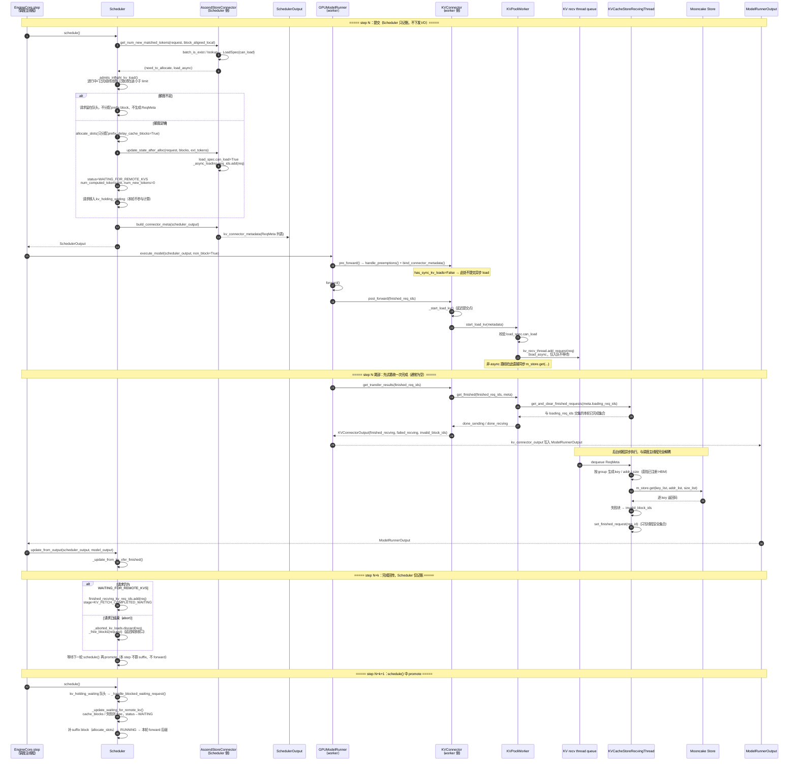

# vLLM 异步 KV Get：任务提交与完成回收时序

本文只描述 REQ-KVP-04 对应的两段流程：

1. **任务提交**：Scheduler 命中外部前缀后如何记账，`Store.get` 由谁在什么位置真正提交。
2. **完成回收**：后台 `get` 结束后，worker 如何把完成结果送回 Scheduler，Scheduler 如何得知并记账。

对应代码：

- vLLM：`D:\L\deepinfer_online\vllm`
- vllm-ascend（Mooncake Store connector）：`D:\L\deepinfer_online\vllm-ascend`

---

## 1. 总体结论

- Scheduler **不提交** `get`，也不持有后台线程。它只产出 `SchedulerOutput.kv_connector_metadata`（`ReqMeta` 列表）。
- 提交点在 **worker 进程 GPUModelRunner 的 `post_forward()`**：`forward` 执行完之后才调用 `start_load_kv()`，刻意让提交不占关键路径；只有 `has_sync_kv_loads=True` 的同步加载才在 `pre_forward()` 里、`forward` 之前提交。
- 完成结果**不是**回调、也**不是** Scheduler 主动 poll Store，而是随 `ModelRunnerOutput.kv_connector_output` 沿 `worker → EngineCore → Scheduler.update_from_output()` 的主数据流回传。
- 同一 step 的 `post_forward()` 里虽然立刻取了一次 `get_transfer_results()`，但后台线程通常尚未完成，所以完成结果一般在**后续 step** 才回传，并在**再下一轮 `schedule()`** 才把请求 promote 出来。

---

## 2. 任务提交与完成回收时序图

---

## 3. 提交链路（step N，逐跳）

**Scheduler 侧（只决策与记账）**

| # | 位置                                                   | 动作                                                                                                                 |
| - | ------------------------------------------------------ | -------------------------------------------------------------------------------------------------------------------- |
| 1 | `vllm/v1/core/sched/scheduler.py:1177`               | `connector.get_num_new_matched_tokens(request, block_aligned_local)`                                               |
| 2 | `vllm-ascend/.../ascend_store/pool_scheduler.py:231` | 查 Store metadata，生成 `LoadSpec`，返回 `(need_to_allocate, load_async)`                                        |
| 3 | `scheduler.py:1325` / `:2842`                      | `_admits_inflight_kv_load()` 额度检查                                                                              |
| 4 | `scheduler.py:1497`                                  | `allocate_slots(..., num_external_computed_tokens=hit, delay_cache_blocks=True)`，只分 prefix                      |
| 5 | `scheduler.py:1544` → `pool_scheduler.py:339`     | `update_state_after_alloc()`：保存 `local_block_ids`、`can_load=True`、加入 `_async_loading_req_ids`         |
| 6 | `scheduler.py:1585-1606`                             | `status=WAITING_FOR_REMOTE_KVS`、`num_computed_tokens=hit`、`num_new_tokens=0`，`skip_request()`             |
| 7 | `scheduler.py:1678`                                  | 请求进入 `kv_holding_waiting`（已持有 block 的等待队列）                                                           |
| 8 | `scheduler.py:1811` → `pool_scheduler.py:601`     | `build_connector_meta()`，`_process_async_load_request()`（`pool_scheduler.py:561`）把未调度请求转 `ReqMeta` |
| 9 | `scheduler.py:1812`                                  | `scheduler_output.kv_connector_metadata = meta`                                                                    |

**Worker 侧（真正提交）**

| #  | 位置                                                           | 动作                                                                                           |
| -- | -------------------------------------------------------------- | ---------------------------------------------------------------------------------------------- |
| 10 | `vllm/v1/engine/core.py:723-724`                             | `step()`：`schedule()` → `model_executor.execute_model(...)`                            |
| 11 | `vllm/v1/worker/gpu/model_runner.py:2107,2131`               | `kv_connector.pre_forward()`                                                                 |
| 12 | `vllm/v1/worker/gpu/kv_connector.py:86-87`                   | `handle_preemptions()` + `bind_connector_metadata()`，把 metadata 交给 worker 侧 connector |
| 13 | `kv_connector.py:92-94`                                      | `has_sync_kv_loads=True` 时在 forward 前调用 `_start_load_kv()`；async 不在此提交          |
| 14 | `gpu/model_runner.py:2306`                                   | `kv_connector.post_forward(finished_req_ids)`                                                |
| 15 | `kv_connector.py:142-143`                                    | `_pending_load_kwargs` 非空 → `_start_load_kv()` ← **异步 get 的提交点**           |
| 16 | `vllm-ascend/.../ascend_store/ascend_store_connector.py:364` | `AscendStoreConnector.start_load_kv()`                                                       |
| 17 | `vllm-ascend/.../ascend_store/pool_worker.py:1345`           | `KVPoolWorker.start_load_kv()`：按 `load_spec.can_load` 过滤                               |
| 18 | `pool_worker.py:1380-1384`                                   | `load_async=True` → `kv_recv_thread.add_request(req)`（入队即返回）                       |
| 19 | `vllm-ascend/.../ascend_store/kv_transfer.py:98`             | `add_request()`：`request_queue.put(req)`                                                  |
| 20 | `kv_transfer.py:1009,1086`                                   | recv 线程 `_handle_request()` → `m_store.get(keys, addrs, sizes)` 直写 HBM                |

> Scheduler 与 Store 之间没有任何直接调用；Scheduler 也不知道这个 task 被哪个线程执行，它只看到一个 status + 一个 req_id。

---

## 4. 完成回收链路（step N+k，逐跳）

| #  | 位置                                             | 动作                                                                                                                                           |
| -- | ------------------------------------------------ | ---------------------------------------------------------------------------------------------------------------------------------------------- |
| 1  | `kv_transfer.py:1138`                          | recv 线程 `set_finished_request(req_id)`（`kv_transfer.py:152`，只写 `finished_requests` 集合）                                          |
| 2  | `kv_connector.py:148`                          | `post_forward()` 里 `get_transfer_results(finished_req_ids)`                                                                               |
| 3  | `ascend_store_connector.py:476`                | `AscendStoreConnector.get_transfer_results()`                                                                                                |
| 4  | `pool_worker.py:853`                           | `KVPoolWorker.get_finished(finished_req_ids, meta)`                                                                                          |
| 5  | `pool_worker.py:885` → `kv_transfer.py:126` | `get_and_clear_finished_requests(meta.loading_req_ids)`：**只上报仍在加载列表里的 req**，天然过滤过期/已取消                           |
| 6  | `kv_connector.py:149-152`                      | 组装 `KVConnectorOutput{finished_sending, finished_recving, failed_recving, invalid_block_ids}`                                              |
| 7  | `gpu/model_runner.py:2306,2428`                | 写入 `ModelRunnerOutput.kv_connector_output`                                                                                                 |
| 8  | `core.py:737`                                  | `scheduler.update_from_output(scheduler_output, model_output)`                                                                               |
| 9  | `scheduler.py:3706`                            | `_update_from_kv_xfer_finished()`：`connector.update_connector_output()` 后按状态分派                                                      |
| 10 | `scheduler.py:3723-3725`                       | 仍是 `WAITING_FOR_REMOTE_KVS` → `finished_recving_kv_req_ids.add()`，stage=`KV_FETCH_COMPLETED_WAITING`                                 |
| 11 | `scheduler.py:3727-3729`                       | 已 finished（abort）→ `_aborted_kv_loads.discard()` + `_free_blocks()`                                                                    |
| 12 | `scheduler.py:3671-3683`                       | **下一轮** `schedule()` 里 `_handle_blocked_waiting_request()` 命中集合 → `_update_waiting_for_remote_kv()` → `status=WAITING` |

**失败分支**

| 场景          | 入口                                               | 处理                                                                                                                                       |
| ------------- | -------------------------------------------------- | ------------------------------------------------------------------------------------------------------------------------------------------ |
| 请求级失败    | `scheduler.py:3839` `_handle_failed_recving()` | `recompute_kv_load_failures=True` 时 `num_computed_tokens=0` + 标记 `failed_recving_kv_req_ids`，不 fail 请求，从头 prefill          |
| 逐 block 失败 | `scheduler.py:3854` `_handle_invalid_blocks()` | `_update_requests_with_invalid_blocks()` 把 `num_computed_tokens` 截断到第一个坏 block 之前（`scheduler.py:3813`），保留连续有效前缀 |

---

## 5. 与 REQ-KVP-04 RFC 的对应关系

| RFC 描述                                      | vLLM 实际实现                                                                            |
| --------------------------------------------- | ---------------------------------------------------------------------------------------- |
| `SchedulerOutputs.kv_load_tasks`            | `SchedulerOutput.kv_connector_metadata`（`ReqMeta` 列表）                            |
| `post_schedule()` 中 `start_load_kv()`    | `GPUModelRunner.post_forward()` 中 `connector.start_load_kv()`                       |
| 下一轮 `step()` 开头 `poll_completions()` | 上一步 `post_forward()` 末尾 `get_transfer_results()`，随 `ModelRunnerOutput` 回传 |
| `kv_loading` + `kv_ready` 两个队列        | `kv_holding_waiting` 单队列 + `finished_recving_kv_req_ids` 集合                     |
| `max_num_inflight_kv_loads` 三项求和        | `scheduler.py:2846-2849` 完全一致                                                      |
| `aborted_kv_loads` 延迟释放                 | `_aborted_kv_loads`（`scheduler.py:3154-3166` 加入，`:3728-3729` 释放）            |
| 部分 block 失败整体回退                       | 默认按 block 截断保留有效前缀；`recompute_kv_load_failures=False` 才 fail 请求         |

结论：vLLM 把「提交」和「收完成」都压进了同一次 `post_forward()`，Scheduler 侧只维护一个持有 block 的等待队列和几个集合，不建独立的 loading/ready 队列，也不需要单独的 poll 接口。
