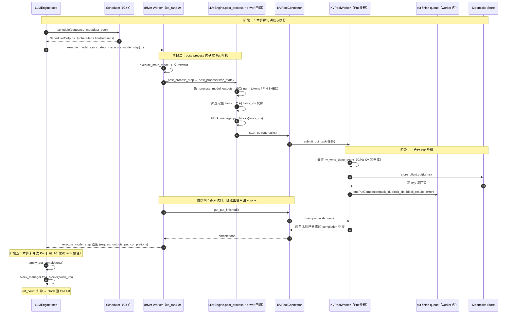
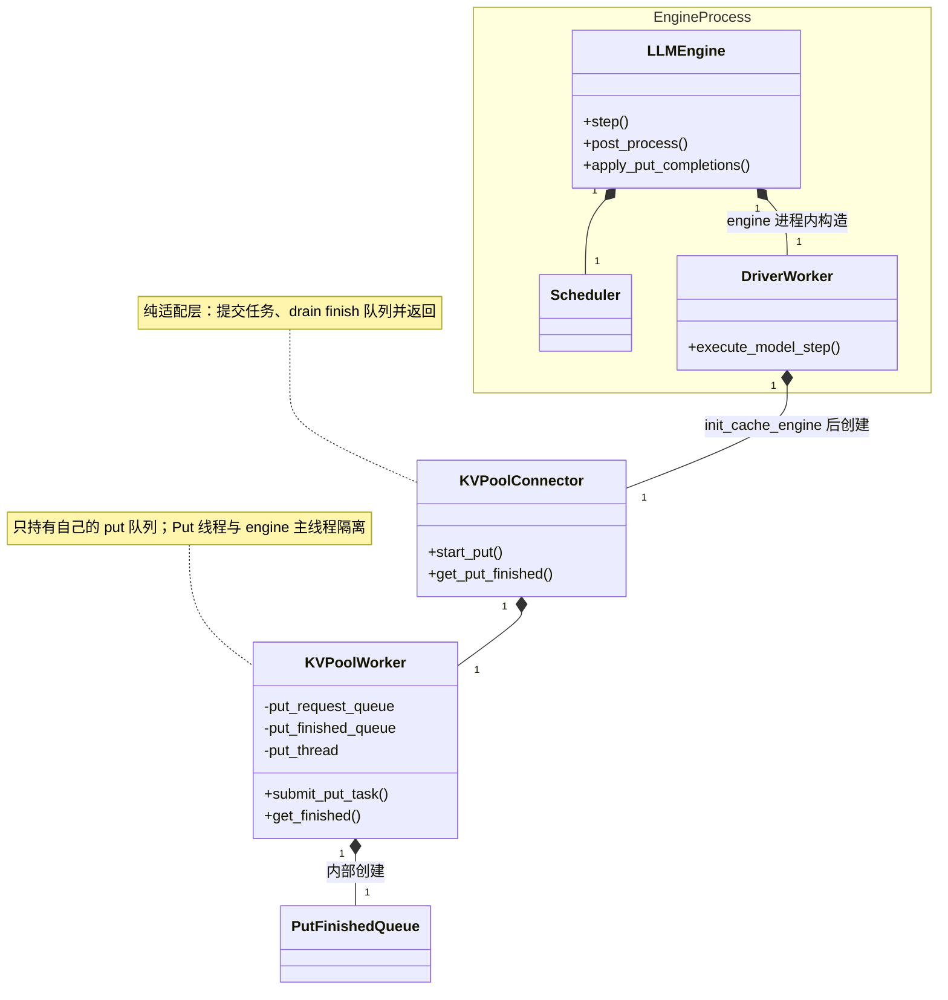

### 1. 关联需求 / Issue

REQ-KVP-06

### 2. 涉及模块

kv-cache-pooling

### 3. 背景与问题

DeepInfer 的 KV block 写入 Mooncake Store 需要与模型执行并行，且 Store worker 读取 HBM 期间不能让 Scheduler 复用源 block。vLLM Mooncake Store 通过保存任务持有独立的 block 引用，worker 完成后再释放；本方案将该生命周期适配到 DeepInfer 的 `LLMEngine`、`BlockManager` 和 Python KV worker。

本方案的总体结构与 REQ-KVP-04（异步 Get）保持一致：**只考虑单 driver worker，完成结果随 driver 返回值回到 `LLMEngine`，在本步末直接应用**；差异只在 Put 的触发时机和 `KVPoolWorker` 的 Put 线程。

### 4. 目标与非目标

### 4.1 目标

- Prefill 结束时，一次性异步写入全部完整 block。
- Decode 期间不按 block 边界提交 Put；请求全部 Decode 结束并完成最终 token 记账后，一次性提交该请求尚未写入 Store 的全部完整 block。
- 未满 block 不作为独立 Store 对象写入；同一请求继续生成后填满该 block，再按完整 block 提交。
- 通过 `pin_blocks`/`free_blocks`（Put 引用释放）保证 Put 期间 HBM block 不被复用。
- Put 失败不阻塞推理，失败 block 后续按 cache miss 处理。

### 4.2 非目标

- 不改变 REQ-KVP-03 的 Store client、连接和重试语义。
- 不在 Decode 中按 block 边界周期性提交 Put。
- 不把未满 block 写入 Store。

### 5. 设计方案

### 5.1 总体流程

Put 只有一个触发来源，两个时机：

- **Prefill 完成**：`post_process()` 中确认本次 prompt 的完整 block 后一次性提交；
- **Decode 全部完成**：请求进入 `FINISHED_*` 且 `process_outputs()` 完成最终 token 记账后，一次性提交尚未写入的全部完整 block（Prefill 尾部未满 block 会与 Decode token 合并后补齐）。

单步时序与 REQ-KVP-04 对称（单 driver worker，不做跨 rank 聚合）：



特殊或新增位置说明：

| #  | 位置                                  | 说明                                                                                                                                                                                                                   |
| -- | ------------------------------------- | ---------------------------------------------------------------------------------------------------------------------------------------------------------------------------------------------------------------------- |
| ① | Put 触发时机                          | Prefill：`post_process()` 且 `chunked_rest_len == 0`；Decode：`_process_model_outputs()` 之后、请求 `is_finished()` 时。两处都在 `LLMEngine.post_process()` 内，早于任何 `finalize_seq()`/`free_seq()`。 |
| ② | `block_ids` 快照 + `pin_blocks()` | 必须在提交前完成：`free_seq_nolock()` 会释放并清空 `seq.cache.block_table`（`csrc/engine/scheduler.hpp`），异步线程不能再去读该表。                                                                              |
| ③ | `start_put()` 调用点                | 单 worker 场景，`KVPoolConnector` 直接由 driver 侧调用，不存在跨进程下发。                                                                                                                                           |
| ④ | `kv_write_done_event`               | 提交时记录当前计算流上的事件，Put 线程 `synchronize()` 后才读 HBM，保证 Store 不会读到未写完的 KV。                                                                                                                  |
| ⑤ | Put 线程                              | `KVPoolWorker` 私有的 daemon 线程，与 engine 主线程不同线程；完成写入 worker 内 finish 队列。                                                                                                                        |
| ⑥ | 完成回传                              | 直接由 `execute_model_step` 的返回值 `(request_outputs, put_completions)` 带回 engine；**没有** per-rank completion 队列，也没有聚合器。                                                                     |
| ⑦ | 应用时机                              | `_execute_model_async_step` 返回后立刻 `apply_put_completions()`：按 `task_id` 释放 Put 引用（`free_blocks`）。                                                                                                |
| ⑧ | 保活                                  | 只要 `pending_put_tasks` 非空，`has_unfinished_requests()` 必须返回真，否则引擎退出后没人消费 completion，被 pin 的 block 永久泄漏。                                                                               |

### 5.2 新增组件、归属与初始化

本方案只考虑单 driver worker，新增 3 个对象（与 REQ-KVP-04 对称，只是线程职责换成 Put）：

| 组件                      | 归属 / 实例数                                   | 运行位置                   | 职责                                                                                                 | 关键方法                                  |
| ------------------------- | ----------------------------------------------- | -------------------------- | ---------------------------------------------------------------------------------------------------- | ----------------------------------------- |
| `KVPoolWorker`          | 1 个，由 `KVPoolConnector` 持有               | engine 进程内（driver 侧） | 本地 put request queue + 后台 Put 线程；等 KV 写完成事件后 `store.put`；完成写入自己的 finish 队列 | `submit_put_task()`、`get_finished()` |
| worker 内 put finish 队列 | 每个 `KVPoolWorker` 私有（每条 Put 线程一条） | 与 worker 同进程           | 线程安全完成集合，只有 Put 线程写、`get_finished()` 读                                             | `put()` / `drain()`                   |
| `KVPoolConnector`       | 1 个，由 driver `Worker` 持有                 | engine 进程内              | 任务转换与提交；步内 drain worker 的 finish 队列并把结果返回给 Worker                                | `start_put()`、`get_put_finished()`   |

> 没有 rank 级 completion 队列，也没有跨 rank 聚合器：完成结果随 `execute_model_step` 的返回值回到 `LLMEngine`，由主线程在本步末应用（见 §5.5 的差异说明）。

组件归属与创建关系（UML 组合关系，`*--` 表示持有，`..>` 表示调用/数据流）：



初始化只有一条硬性顺序约束：**worker 侧组件必须晚于 `init_cache_engine()`（`base.py:270-272`）创建**，此时才有 `gpu_cache` 地址可交给 Store；不要放在 `Worker.__init__` 里。完整伪代码见 §6.5。

线程归属：Put 线程是 driver 进程内的 daemon 线程（至少一条），只写本 worker 的 finish 队列；`execute_model_step` 里由 `KVPoolConnector.get_put_finished()` 同步 drain 并随返回值带回；engine 主线程在本步末应用并释放 Put 引用。

### 5.3 HBM 生命周期与 block 引用

每个 block 至少有两类引用：

```text
request 引用：Scheduler 分配 block 时产生
Put 引用：PutTask 提交前 pin 产生
```

请求结束时：

```text
finalize_seq() -> free_seq() -> 释放 request 引用
Put 完成      -> free_blocks(block_ids) -> 释放 Put 引用 -> ref_count == 0 时回到 free list
```

`PutTask` 必须保存独立的 `block_ids` 快照，不能异步读取 `seq.cache.block_table`。DeepInfer 的 `free_seq_nolock()` 会释放并清空该表，见 `DeepInfer/csrc/engine/scheduler.hpp`。

### 5.4 Put 失败与取消

- **Put 失败不影响推理**：`store.put` 返回 `False` 或抛异常时，仍产生 `PutCompletion`（`block_results` 全 `False` + `error`）；引擎照常释放 Put 引用，失败 block 后续按下一次查询 miss 处理。
- **成功语义**：REQ-KVP-03 中 `put` 的 `True` 含 `-705 = OBJECT_ALREADY_EXISTS`（幂等成功），本方案沿用（`store_client` 内部归一，接入层无需区分）。
- **请求取消/结束**：已提交的 Put 由 Put 引用保护，不受 `free_seq()` 影响；completion 到达后统一 `free_blocks()` 释放一次。
- **重复/未知 completion**：按 `task_id` 在 `pending_put_tasks` 中查表，查不到直接丢弃，保证不重复释放引用。

### 5.5 与现有 DeepInfer 入口的接入

现有主流程（`LLMEngine.step()`，`deepinfer/engine/llm_engine.py:860-959`）：

```text
LLMEngine.step()
    → Scheduler.schedule(sequence_metadata_pool)      # llm_engine.py:885
    → post_schedule(scheduler_outputs)                # llm_engine.py:908
    → _execute_model_async_step(...)                  # llm_engine.py:952
        → _run_workers("execute_model_step", ...)     # :965 → worker/base.py:290-302
            → driver：Worker.execute_model_step       # worker/worker.py:89
                → forward（execute_main_model）        # worker.py:121-127
                → post_process / sample                # worker.py:144-187
    → return request_outputs
```

接入异步 Put 后的顺序（与 §5.1 时序一一对应）：

```text
LLMEngine.step()
    → Scheduler.schedule(sequence_metadata_pool)              # ①
    → post_schedule(scheduler_outputs)                        # ② 原有扩展点
    → _execute_model_async_step(...)                          # ③ 返回 (request_outputs, put_completions)
        → driver：Worker.execute_model_step(...)
            → forward 下发                                    # ③-1
            → post_process → LLMEngine.post_process           # ③-2 提交 Put
                → _process_model_outputs（先完成记账）
                → submit_prefill_puts / submit_final_decode_puts
                    → pin_blocks + 构造 PutTask → start_put
                        → KVPoolWorker.submit_put_task → Put 线程
            → sample                                          # ③-3
            → KVPoolConnector.get_put_finished()              # ③-4 步末收口
            → return (request_outputs, put_completions)       # ④ 完成随返回值带回
    → apply_put_completions(put_completions)                  # ⑤ 本步末释放 Put 引用
    → return request_outputs
```

| #     | 接入点           | 代码位置                                                                                             | 说明                                                                                                           |
| ----- | ---------------- | ---------------------------------------------------------------------------------------------------- | -------------------------------------------------------------------------------------------------------------- |
| ①/② | 调度与扩展点不变 | `llm_engine.py:885`、`:908`                                                                      | Put 不依赖 Scheduler 的额外状态，只需 `scheduled_seqs`/`finished_seqs`。                                   |
| ③-2  | Put 提交         | `LLMEngine.post_process()`（由 driver 的 `_post_process_step` 回调，`worker.py:144`/`:271`） | Prefill 在 `prompt_run` 分支提交；Decode 在 `_process_model_outputs()` 之后、`finalize_seq()` 之前提交。 |
| ③-4  | 收口             | `worker.py:262-263` 的 `sample_end_evt.synchronize()` 之后、返回之前                             | 一次 drain，不影响 forward 关键路径。                                                                          |
| ④    | 完成回传         | `execute_model_step` 返回值 `(request_outputs, put_completions)`                                 | 单 worker，无跨进程队列或聚合。                                                                                |
| ⑤    | 应用完成         | `_execute_model_async_step` 返回后立即 `apply_put_completions()`                                 | 按 `task_id` 执行 `free_blocks()` 释放 Put 引用。                                                          |

### 5.7 实现边界

- `LLMEngine` 负责 Put 时机判定、`block_ids` 快照、`pin_blocks`/`free_blocks` 与 `pending_put_tasks` 台账。
- `KVPoolWorker` 只负责"等事件 → `store.put` → 发布完成"，不修改 `Sequence`、`Scheduler` 队列或 `BlockManager`。
- Put 引用与 request 引用相互独立：请求可以先行 `free_seq()`，Put 完成后由 completion 释放最后一份引用。

### 6. 目录结构与伪代码

### 目录结构

```text
deepinfer/kv_cache/pool/connector.py  : KVPoolConnector（单实例）：start_put（任务转换与提交）、get_put_finished（步内 drain worker 的 finish 队列并返回给 Worker）
deepinfer/kv_cache/pool/worker.py     : KVPoolWorker（单实例，Connector 持有）：put request queue + 后台 Put 线程，复用 REQ-KVP-02 key 生成与 REQ-KVP-03 MooncakeStoreClient.put()，完成写入自己的 finish 队列；不感知 engine 侧对象
```

`KVPoolWorker` 只做传输并把完成写进自己的 finish 队列；`KVPoolConnector` 只做适配，步内 drain 后把结果返回给 `Worker`；完成结果随 `execute_model_step` 的返回值回到 `LLMEngine`，由主线程在本步末应用。

以下伪代码只定义本需求新增的异步 Put 交接，不替换 DeepInfer 现有的普通 Prefill、Decode 和 `process_outputs()` 路径。实际 Store 字节读写仍复用 REQ-KVP-03 的 `MooncakeStoreClient.put()`。

### 6.1 数据对象

```python
from dataclasses import dataclass


@dataclass(frozen=True)
class PoolPutTask:
    """driver worker → 后台 Put 线程；只描述任务，不做 I/O。"""

    task_id: int
    request_id: str
    tenant: str
    keys: tuple[str, ...]               # REQ-KVP-02 生成的 block key
    addrs: tuple[int, ...]              # 已注册 HBM 中每个完整 block 的地址
    sizes: tuple[int, ...]
    block_ids: tuple[int, ...]          # 独立快照，不能异步读取 seq.block_table
    start_block: int
    end_block: int
    kind: str                           # 阶段一固定 "block"
    replica_config: object              # REQ-KVP-03 的 ReplicateConfig
    kv_write_done_event: object         # 提交时记录的 GPU 写完成事件


@dataclass(frozen=True)
class PutCompletion:
    """后台 Put 线程 → engine。"""

    task_id: int
    request_id: str
    block_ids: tuple[int, ...]
    block_results: list[bool]           # 与 block_ids 等长；成功含 -705 幂等
    error: BaseException | None = None
```

每个请求维护单调推进的 `next_unsaved_block`（初值 0），表示"起点之前的完整 block 已提交过 Put"。它属于池化状态，建议放 Python side table，不写进 `SequenceMetadata`。

### 6.2 LLMEngine：Put 时机、台账与引用释放

```text
class LLMEngine:
    def step(self):
        # 0. 保活前提：pending_put_tasks 非空时 has_unfinished_requests() 必须为真，
        #    否则引擎退出后没人消费 completion，被 pin 的 block 永久泄漏。

        # 1. 本步正常调度与执行；Put 提交发生在 post_process 回调里。
        seq_metadata_list, scheduler_outputs = self.scheduler.schedule(
            self.sequence_metadata_pool
        )
        self.post_schedule(scheduler_outputs)
        request_outputs, put_completions = self._execute_model_async_step(
            seq_metadata_list, scheduler_outputs
        )

        # 2. 本步末直接释放 Put 引用（单 worker，无聚合）。
        if put_completions:
            self.apply_put_completions(put_completions)
        return request_outputs

    def _execute_model_async_step(self, seq_metadata_list, scheduler_outputs):
        # driver worker 在 engine 进程内，run_workers 返回它的返回值（现在是二元组）
        request_outputs, put_completions = self._run_workers(
            "execute_model_step",
            driver_kwargs=dict(
                seq_metadata_list=seq_metadata_list,
                scheduler_outputs=scheduler_outputs,
            ),
            is_prompt=scheduler_outputs.prompt_run,
            is_placeholder=scheduler_outputs.is_empty(),
        )
        self.deferred_release.collect_request_outputs(request_outputs)
        return request_outputs, put_completions

    def post_process(self, step_state):
        output = step_state.sampler_output
        scheduler_outputs = step_state.scheduler_outputs

        # 先完成 process_outputs，更新 cache.num_tokens 与 FINISHED_* 状态。
        request_outputs = self._process_model_outputs(output, scheduler_outputs)

        if scheduler_outputs.prompt_run:
            self.submit_prefill_puts(scheduler_outputs.scheduled_seqs)
        else:
            # 只检查本轮刚完成的请求；必须早于 finalize_seq()/free_seq()。
            self.submit_final_decode_puts(scheduler_outputs.scheduled_seqs)

        return request_outputs

    def submit_prefill_puts(self, seqs):
        for seq in seqs:
            if seq.chunked_rest_len != 0:      # chunk 未结束不提交
                continue
            full_blocks = seq.cache.num_tokens // self.block_size
            start = seq.next_unsaved_block
            if full_blocks <= start:
                continue
            block_ids = copy(seq.cache.block_table[start:full_blocks])
            self._submit_put_task(seq, block_ids, start, full_blocks)
            seq.next_unsaved_block = full_blocks

    def submit_final_decode_puts(self, seqs):
        # 此时 num_tokens 已包含本轮实际接受的 token；
        # Prefill 尾部未满 block 在此与 Decode token 合并后提交。
        for seq in seqs:
            if not seq.is_finished():
                continue
            full_blocks = seq.cache.num_tokens // self.block_size
            start = seq.next_unsaved_block
            if full_blocks <= start:
                continue
            block_ids = copy(seq.cache.block_table[start:full_blocks])
            if len(block_ids) != full_blocks - start:
                raise RuntimeError("block table shorter than full block count")
            self._submit_put_task(seq, block_ids, start, full_blocks)
            seq.next_unsaved_block = full_blocks

    def _submit_put_task(self, seq, block_ids, start_block, end_block):
        if not block_ids:
            return

        # request 引用可能随后由 free_seq() 释放；先增加 Put 引用。
        self.block_manager.pin_blocks(block_ids)

        task = PoolPutTask(
            task_id=self.next_put_task_id(),
            request_id=seq.request_id,
            tenant=self.cfg.block_tenant,
            keys=make_block_keys(                  # REQ-KVP-02 的 hash/PoolKey helper
                seq.prompt_token_ids,
                start_block=start_block,
                end_block=end_block,
                block_size=self.block_size,
                layout_version=self.cfg.layout_version,
                rank_info=self.rank_info,
            ),
            addrs=[self.gpu_blocks_ptr + bid * self.block_bytes for bid in block_ids],
            sizes=[self.block_bytes] * len(block_ids),
            block_ids=copy(block_ids),
            start_block=start_block,
            end_block=end_block,
            kind="block",
            replica_config=self.cfg.block_rep,
            kv_write_done_event=record_kv_write_event(),
        )
        self.pending_put_tasks[task.task_id] = task
        self.kv_pool_connector.start_put([task])

    def apply_put_completions(self, completions):
        for completion in completions:
            task = self.pending_put_tasks.pop(completion.task_id, None)
            if task is None:
                continue                            # 重复/未知 completion
            # DeepInfer 没有独立 unpin；free_blocks() 减少 Put 引用，
            # ref_count == 0 时自动回到 free list。
            self.block_manager.free_blocks(completion.block_ids)
```

### 6.3 KVPoolConnector：Engine 与 Worker 的适配层

```text
class KVPoolConnector:                  # 单实例，由 driver Worker 持有
    def __init__(self, worker):
        self.worker = worker
        self._inflight = set()          # task_id

    def start_put(self, tasks):
        # 不调用 Store put；只做任务转换与入队
        for task in tasks:
            self._inflight.add(task.task_id)
            self.worker.submit_put_task(self._build_worker_task(task))

    def get_put_finished(self):
        # 步内收口：drain worker 的 finish 队列并返回，由 Worker 随返回值带回 engine
        out = []
        for c in self.worker.get_finished():
            if c.task_id in self._inflight:
                self._inflight.discard(c.task_id)
                out.append(c)
        return out

    def _build_worker_task(self, task):
        return KVPoolWorkerTask(
            task_id=task.task_id,
            request_id=task.request_id,
            tenant=task.tenant,
            keys=task.keys,
            addrs=task.addrs,
            sizes=task.sizes,
            block_ids=task.block_ids,
            replica_config=task.replica_config,
            kv_write_done_event=task.kv_write_done_event,
        )
```

### 6.4 KVPoolWorker：后台 Put 队列和 Store Put

```text
class KVPoolWorker:
    def __init__(self, store_client, gpu_cache, rank_info):
        self.store_client = store_client       # REQ-KVP-03
        self.gpu_cache = gpu_cache
        self.rank_info = rank_info
        self.put_request_queue = Queue()
        self.put_finished_queue = Queue()      # 线程内完成集合，不感知 engine
        self.put_thread = Thread(target=self._run_put_loop, daemon=True)
        self.put_thread.start()

    def submit_put_task(self, task):
        self.put_request_queue.put(task)

    def _run_put_loop(self):
        while not self.stopping:
            task = self.put_request_queue.get()
            try:
                self.put_finished_queue.put(self._execute_put(task))
            finally:
                self.put_request_queue.task_done()

    def get_finished(self):
        done = []
        while True:
            try:
                done.append(self.put_finished_queue.get_nowait())
            except Empty:
                break
        return done

    def _execute_put(self, task):
        try:
            # 等最后一次 GPU KV 写入完成，避免 Store 读到未完成数据。
            task.kv_write_done_event.synchronize()

            # 地址/长度由 engine 侧按 DeepInfer KV 布局切好（整块单段），
            # 这里只按 key 组装 PutItem。
            items = [
                PutItem(key=key, segments=[(addr, size)])
                for key, addr, size in zip(task.keys, task.addrs, task.sizes, strict=True)
            ]
            results = self.store_client.put(items)     # REQ-KVP-03，内部含 -705 幂等归一
            return PutCompletion(task.task_id, task.request_id,
                                 task.block_ids, results, None)
        except Exception as exc:
            return PutCompletion(task.task_id, task.request_id,
                                 task.block_ids,
                                 [False] * len(task.block_ids), exc)
```

`KVPoolWorker` 不直接修改 `Sequence`、`Scheduler` 或 `BlockManager`；completion 返回主线程后由 `LLMEngine.apply_put_completions()` 释放 Put 引用。

### 6.5 初始化：单 worker

初始化只列新增部分。唯一硬性顺序约束是：worker 侧组件必须在 `init_cache_engine()` 之后创建，此时 `gpu_cache` 才存在。

```text
# ── engine 进程（driver worker 也在本进程）───────────────────────────────
self._init_workers()                                 # llm_engine.py:233
self._run_workers("load_model")                      # 241 行
self._init_cache()                                   # 244 行 → 内部 453 行执行 init_cache_engine
self.scheduler = self._create_scheduler()            # 267 行；本方案不新增聚合器
```

```text
# ── driver worker 侧 ─────────────────────────────────────────────────────
WorkerBase.init_cache_engine                         # base.py:270-272
    self.cache_engine = CacheEngine(...)
    self.gpu_cache = self.cache_engine.gpu_cache     # 此时 HBM segment 才存在
    if kv_pool_enabled:
        self.kv_pool_connector = KVPoolConnector(    # 纯适配层
            worker=KVPoolWorker(
                store_client=...,                    # REQ-KVP-03 的 MooncakeStoreClient
                gpu_cache=self.gpu_cache,
                rank_info=...,                       # 用于生成 key 的 shard 信息
            )                                        # 内部建 put 队列 + 起 Put 线程
        )
        register_hbm_segments(self.gpu_cache)        # 复用 REQ-KVP-01 的注册
```

### 6.6 Worker：步内提交与回传

```text
class Worker:   # 本方案只考虑 driver worker
    def __init__(self, ...):
        self.kv_pool_connector = None            # kv_pool 未启用时保持 None

    def execute_model_step(self, ..., ):
        # 1. forward（原有逻辑；is_placeholder 的 dummy 分支同样会走到下面）
        ... execute_main_model ...

        # 2. post_process：内部会提交本轮 Put（见 §6.2）
        request_outputs = ...

        # 3. 步末收口（单 worker）
        put_completions = []
        if self.kv_pool_connector is not None:
            put_completions = self.kv_pool_connector.get_put_finished()

        # 4. 完成结果随返回值带回 engine（无队列、无聚合）
        return request_outputs, put_completions
```

收口点在 `worker.py:262-263` 的 `sample_end_evt.synchronize()` 之后、`execute_model_step` 返回之前；提交点（`post_process`）在 forward 之后，两者都不占 forward 关键路径。

### 7. 对外接口

| 接口                                   | 调用方 -> 被调用方                      | 用途                                            |
| -------------------------------------- | --------------------------------------- | ----------------------------------------------- |
| `LLMEngine.apply_put_completions()`  | `LLMEngine` -> `BlockManager`       | 按 `task_id` 释放 Put 引用（`free_blocks`） |
| `KVPoolConnector.start_put()`        | `LLMEngine` -> `KVPoolConnector`    | 把 `PoolPutTask` 转成 worker 任务并入队       |
| `KVPoolConnector.get_put_finished()` | `Worker` -> `KVPoolConnector`       | 步内 drain worker 的 finish 队列并返回          |
| `KVPoolWorker.submit_put_task()`     | `KVPoolConnector` -> `KVPoolWorker` | 后台 Put 任务入队                               |
| `KVPoolWorker.get_finished()`        | `KVPoolConnector` -> `KVPoolWorker` | drain 本 worker 的 finish 队列                  |
| `Worker.execute_model_step()`        | `LLMEngine` -> `Worker`             | 返回 `(request_outputs, put_completions)`     |

### 8. 备选方案与权衡

_No response_

### 9. 测试用例与标准

| 用例编号     | 类型     | 测试目的                    | 前置条件                                                         | 步骤                                                                                       | 预期结果                                                                                                                   |
| ------------ | -------- | --------------------------- | ---------------------------------------------------------------- | ------------------------------------------------------------------------------------------ | -------------------------------------------------------------------------------------------------------------------------- |
| TC-KVP-06-01 | 正常     | 普通 Prefill 写入完整 block | prompt 长度为 block size 的整数倍                                | 执行一次 Prefill 并检查 Store                                                              | 只提交一次 Put，block pin 在完成前保持，completion 应用后释放。                                                            |
| TC-KVP-06-02 | 边界     | Prefill 尾部与 Decode 合并  | prompt 长度不是 block size 的整数倍                              | Prefill 后保留未满尾 block，继续 Decode 直至该 block 填满并结束请求                        | Prefill 尾部不单独 Put；请求结束时与 Decode token 合并成完整 block，只提交一次。                                           |
| TC-KVP-06-03 | 正常     | Decode 结束一次性写入       | Decode 跨越多个 block 边界                                       | Decode 期间不提交 Put；结束后执行 `process_outputs()` 和最终 Put 检查                    | 一次提交所有尚未提交的完整 block；未满尾 block 不提交；不重复提交 Prefill block。                                          |
| TC-KVP-06-04 | 生命周期 | 最终 Put 与请求释放并行     | Put worker 延迟完成                                              | 请求完成后先提交最终 Put，再触发 `finalize_seq()`                                        | request 引用释放后，Put 引用仍保持；completion 应用后 block 才回到 free list。                                             |
| TC-KVP-06-05 | 异常     | Store 失败清理              | Store.put 返回失败或抛异常                                       | 注入失败并执行本步末的 `apply_put_completions()`                                         | 推理继续；任务记录失败；所有 pin 均释放。                                                                                  |
| TC-KVP-06-06 | 并发     | 多请求 Put 并发             | 两个请求同时产生完整 block                                       | 同时提交任务并延迟不同完成时间                                                             | task 独立完成和释放引用，不发生 block 误释放。                                                                             |
| TC-KVP-06-07 | 性能     | 端到端 Decode 性能影响      | 固定模型、输入分布、并发度和 Decode 长度；分别关闭和开启异步 Put | 完成预热后，分别执行 Decode 基线和异步 Put 测试，采集 Decode 吞吐、单 token 延迟等性能时间 | 异步 Put 与 Decode 计算重叠，不阻塞 Decode 调度；性能指标满足既定基线容差，Put 任务能够正常完成且无 block 泄漏或异常增长。 |
| TC-KVP-06-08 | 保活     | pending Put 期间引擎不退出  | 请求已结束但 Put 未完成                                          | 检查 `has_unfinished_requests()` 与后续 step                                             | 引擎继续 step 并消费 completion；不会因无请求而退出导致 block 永久 pin。                                                   |

### 10. 实施计划

_No response_

### 11. 遗留问题

### 待确认的遗留问题

- 问题：

### 确认暂不解决的问题

- 问题：
  暂不解决的原因：
