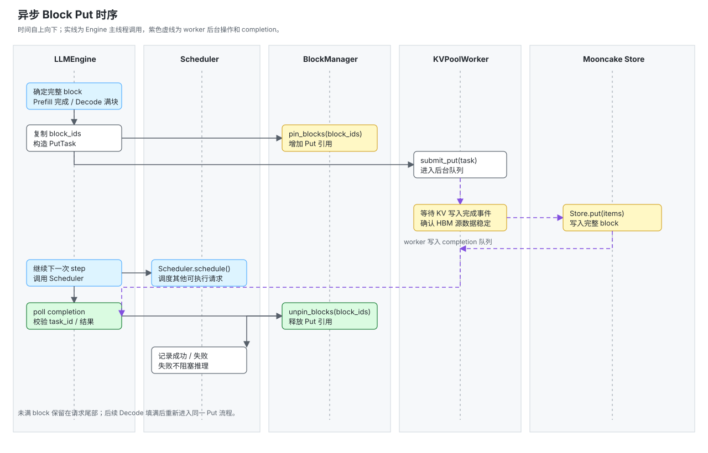

# REQ-KVP-06 Prefill 与 Decode 完整 Block 的异步 KV Put

## 1. 引言

### 1.1 背景

DeepInfer 的 KV block 写入 Mooncake Store 需要与模型执行并行，且 Store worker 读取 HBM 期间不能让 Scheduler 复用源 block。vLLM Mooncake Store 通过保存任务持有独立的 block 引用，worker 完成后再释放；本方案将该生命周期适配到 DeepInfer 的 `LLMEngine`、`BlockManager` 和 Python KV worker。

### 1.2 目标与范围

- Prefill 结束时，一次性异步写入全部完整 block。
- Decode 期间不按 block 边界提交 Put；请求全部 Decode 结束并完成最终 token 记账后，一次性提交该请求尚未写入 Store 的全部完整 block。
- 未满 block 不作为独立 Store 对象写入；同一请求继续生成后填满该 block，再按完整 block 提交。
- 通过 `pin_blocks`/`unpin_blocks` 保证 Put 期间 HBM block 不被复用。
- Put 失败不阻塞推理，失败 block 后续按 cache miss 处理。

## 2. 设计说明

### 2.1 写入触发条件

#### Prefill

普通 Prefill 在模型执行完成并进入 `post_process()` 后，一次性确定并提交本次 prompt 的全部完整 block。

#### Decode

Decode 期间只更新 GPU KV cache，不提交 Put。请求在 `process_outputs()` 中完成最终 token 记账并进入 `FINISHED_*` 后，Engine 计算最终 `cache.num_tokens // block_size`。从 `next_unsaved_block` 开始，提交所有尚未写入 Store 的完整 block；Prefill 尾部未满 block 会与 Decode 生成的 token 共同填满对应 block，因此会在请求结束时与后续完整 block 一起提交。最终仍未满的尾 block 不写入 Store。

### 2.2 总体流程



1. `LLMEngine` 在 Prefill 的 `post_process()` 中确定本次 prompt 的完整 block；Decode 期间不提交 Put。请求在 Decode 全部结束并由 `process_outputs()` 更新最终 `cache.num_tokens` 后，确定本次请求所有尚未提交的完整 block。Prefill 尾部未满 block 与 Decode token 合并后按完整 block 提交。
2. Engine 复制 block ID 快照并调用 `BlockManager.pin_blocks()`。
3. Engine 创建 `PutTask`，携带 key、HBM 地址、长度、block ID 和 GPU 写入完成 event，提交到 `KVPoolWorker`。
4. worker 等待“KV 写入完成事件”后调用 Mooncake Store `put`，不修改 `Sequence` 或 Scheduler 状态。
5. worker 将 `PutCompletion` 写入完成队列；成功、失败和异常都必须产生完成结果。
6. Engine 在下一次 step 的 completion poll 中消费结果，并调用 `unpin_blocks()`。
7. Scheduler 可以在 Put 进行期间释放请求自身的 block 引用；Put task 的引用独立保留，直到 completion 被消费。

### 2.3 HBM 生命周期

每个 block 至少有两类引用：

```text
request 引用：Scheduler 分配 block 时产生
Put 引用：PutTask 提交前 pin 产生
```

请求结束时：

```text
finalize_seq() -> free_seq() -> 释放 request 引用
Put 完成      -> unpin_blocks() -> 释放 Put 引用
```

`PutTask` 必须保存独立的 `block_ids` 快照，不能异步读取 `seq.cache.block_table`。DeepInfer 的 `free_seq_nolock()` 会释放并清空该表，见 `DeepInfer/csrc/engine/scheduler.hpp`。

## 3. DeepInfer 主流程接入

### 3.1 Prefill 接入

```text
LLMEngine.step()
  -> Scheduler.schedule()
  -> Worker.execute_model_step()
  -> Worker._post_process_step()
       -> LLMEngine.post_process()
            -> pe_do_save_kvcache(seqs)
```

本需求在 `post_process()` 中调用 `pe_do_save_kvcache(seqs)` 接入 Prefill 异步 Put。该函数负责筛选完整 Prefill、复制 block ID、pin block、构造 `PoolPutTask` 并调用 `KVPoolWorker.submit_put()`。

### 3.2 Decode 接入

Decode 不在 `pre_sampler_sync()` 中按 block 边界提交 Put。`pre_sampler_sync()` 早于当前轮 `scheduler.process_outputs()`，此时 `cache.num_tokens` 还未包含当前轮最终接受的 token。

最终 Decode Put 接入 `LLMEngine.post_process()`：先调用 `_process_model_outputs()` 完成 `scheduler.process_outputs()`，再筛选本轮 `scheduled_seqs` 中已经进入 `FINISHED_*` 的请求，计算最终完整 block，复制 block ID、pin block、构造并提交一个覆盖全部尚未提交完整 block 的 `PoolPutTask`。该动作必须早于后续任何 `free_seq()`/`finalize_seq()`。

### 3.3 Completion 接入

`LLMEngine.step()` 在调用 `Scheduler.schedule()` 前执行：

```text
completions = kv_pool_worker.poll_put_completions()
for completion in completions:
    if completion.task_id 未处理:
        block_manager.unpin_blocks(completion.block_ids)
        标记 task 完成
```

如果 Engine 没有可执行请求，但仍有 pending Put，Engine 必须继续运行 completion poll，避免已完成任务的 block 永久保持 pin。

## 4. 关键流程伪代码

### 4.1 LLMEngine 保存钩子

```text
class LLMEngine:
    def pre_sampler_sync(self, scheduler_outputs):
        # Decode 不在这里提交 Put：当前轮 token 尚未经过 process_outputs
        # 记账。这里保留 DeepInfer 原有同步和其他 pre-sampler 逻辑。
        for seq in scheduler_outputs.finished_seqs:
            self.finalize_seq(seq)

    def post_process(self, step_state):
        output = step_state.sampler_output
        if step_state.scheduler_outputs.prompt_run:
            request_outputs = self._process_model_outputs(
                output, step_state.scheduler_outputs
            )
            self.pe_do_save_kvcache(
                step_state.scheduler_outputs.scheduled_seqs
            )
            return request_outputs

        # Decode 必须先完成 process_outputs，才能看到当前轮最终 token、
        # cache.num_tokens 和 FINISHED_* 状态。
        request_outputs = self._process_model_outputs(
            output, step_state.scheduler_outputs
        )
        self.submit_final_decode_puts(
            step_state.scheduler_outputs.scheduled_seqs
        )
        return request_outputs

    def pe_do_save_kvcache(self, seqs):
        # 普通 Prefill 一次完成；chunked_rest_len 保留为防御性检查。
        for seq in seqs:
            if seq.chunked_rest_len != 0:
                continue

            block_size = seq.block_size
            full_blocks = seq.num_cached_tokens // block_size
            if full_blocks == 0:
                continue

            block_ids = list(
                connector.block_table_of(seq)[:full_blocks]
            )
            if not block_ids:
                continue

            # request 引用可能在本轮 post_process 后释放；Put 引用必须独立保留。
            self.block_manager.pin_blocks(block_ids)

            task = PoolPutTask(
                task_id=self.next_put_task_id(),
                tenant=self.cfg.block_tenant,
                keys=make_block_keys(
                    seq.prompt_token_ids,
                    full_blocks * block_size,
                ),
                addrs=[
                    self.gpu_blocks_ptr + bid * self.block_bytes
                    for bid in block_ids
                ],
                sizes=[self.block_bytes] * full_blocks,
                block_ids=block_ids,
                kind="block",
                rep=self.cfg.block_rep,
                kv_write_done_event=record_current_device_event(),
            )
            self.pending_put_tasks[task.task_id] = task
            self.kv_pool_worker.submit_put(task)

            # Prefill 已提交到 full_blocks；Decode 结束时从这里继续提交，
            # 避免重复写入 Prefill 已经完成的 block。
            seq.next_unsaved_block = full_blocks

    def submit_final_decode_puts(self, seqs):
        # 必须在 _process_model_outputs() 之后调用；此时 cache.num_tokens
        # 已包含当前 Decode step 实际接受的 token。
        for seq in seqs:
            if not seq.is_finished():
                continue

            full_blocks = seq.cache.num_tokens // self.block_size
            start = seq.next_unsaved_block
            if full_blocks <= start:
                continue

            block_ids = list(seq.cache.block_table[start:full_blocks])
            if len(block_ids) != full_blocks - start:
                raise RuntimeError("block table shorter than final full block count")

            self.block_manager.pin_blocks(block_ids)
            task = PoolPutTask(
                task_id=self.next_put_task_id(),
                tenant=self.cfg.block_tenant,
                keys=make_block_keys(
                    seq.prompt_token_ids,
                    full_blocks * self.block_size,
                    start_block=start,
                ),
                addrs=[
                    self.gpu_blocks_ptr + bid * self.block_bytes
                    for bid in block_ids
                ],
                sizes=[self.block_bytes] * len(block_ids),
                block_ids=block_ids,
                kind="block",
                rep=self.cfg.block_rep,
                kv_write_done_event=record_current_device_event(),
            )
            self.pending_put_tasks[task.task_id] = task
            self.kv_pool_worker.submit_put(task)
            seq.next_unsaved_block = full_blocks
```

### 4.2 `KVPoolWorker` Put 执行

```text
class KVPoolWorker:
    def submit_put(self, task):
        put_queue.put(task)

    def run_put_task(self, task):
        try:
            # ready_event 必须由模型 KV 写入 stream 在最后一次 KV 写入之后记录。
            # 这里只阻塞 Put worker，确保 Store 读取 HBM 时源 block 已经稳定。
            task.kv_write_done_event.synchronize()
            items = [
                PutItem(key=key, segments=[(addr, size)])
                for key, addr, size in zip(
                    task.keys, task.addrs, task.sizes, strict=True
                )
            ]
            # 复用上游 MooncakeStoreClient.put(items)；client 内部调用
            # batch_put_from_multi_buffers，并将底层 0/-705 归一为成功布尔值。
            result = mooncake_store.put(items)
        except Exception as error:
            result = PutFailure(error)
        completion_queue.put(PutCompletion(task.task_id, task.block_ids, result))

    def poll_put_completions(self):
        completions = []
        for completion in completion_queue.drain():
            task = pending_tasks.remove(completion.task_id)
            if task is None:
                continue
            completions.append(completion)
        return completions
```

`LLMEngine` 在调用 `KVPoolWorker.submit_put()` 前完成以下动作：复制 `block_ids`、调用 `pin_blocks()`、构造 key/address/size，并将 task 放入 pending 表。`KVPoolWorker` 不直接修改 `BlockManager` 或 `Sequence`。

## 5. 测试用例

| 用例编号     | 类型     | 测试目的                    | 前置条件                            | 步骤                                       | 预期结果                                                            |
| ------------ | -------- | --------------------------- | ----------------------------------- | ------------------------------------------ | ------------------------------------------------------------------- |
| TC-KVP-06-01 | 正常     | 普通 Prefill 写入完整 block | prompt 长度为 block size 的整数倍   | 执行一次 Prefill 并检查 Store              | 只提交一次 Put，block pin 在完成前保持，完成后 unpin。              |
| TC-KVP-06-02 | 边界     | Prefill 尾部与 Decode 合并 | prompt 长度不是 block size 的整数倍 | Prefill 后保留未满尾 block，继续 Decode 直至该 block 填满并结束请求 | Prefill 尾部不单独 Put；请求结束时与 Decode token 合并成完整 block，只提交一次。 |
| TC-KVP-06-03 | 正常     | Decode 结束一次性写入      | Decode 跨越多个 block 边界          | Decode 期间不提交 Put；结束后执行 `process_outputs()` 和最终 Put 检查       | 一次提交所有尚未提交的完整 block；未满尾 block 不提交；不重复提交 Prefill block。 |
| TC-KVP-06-04 | 生命周期 | 最终 Put 与请求释放并行    | Put worker 延迟完成                 | 请求完成后先提交最终 Put，再触发 `finalize_seq()`                          | request 引用释放后，Put 引用仍保持；完成后 block 才回到 free list。           |
| TC-KVP-06-05 | 异常     | Store 失败清理              | Store.put 返回失败或抛异常          | 注入失败并执行 completion poll             | 推理继续；任务记录失败；所有 pin 均释放。                           |
| TC-KVP-06-06 | 并发     | 多请求 Put 并发             | 两个请求同时产生完整 block          | 同时提交任务并延迟不同完成时间             | task 独立完成和 unpin，不发生 block 误释放。                        |
