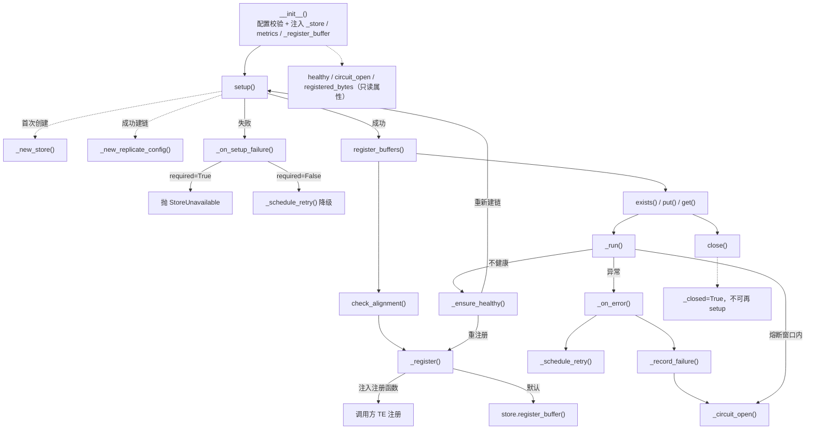
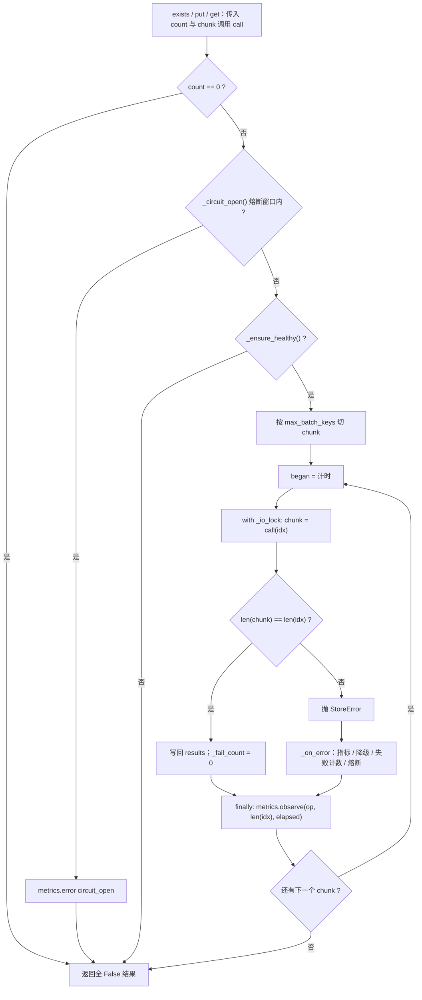
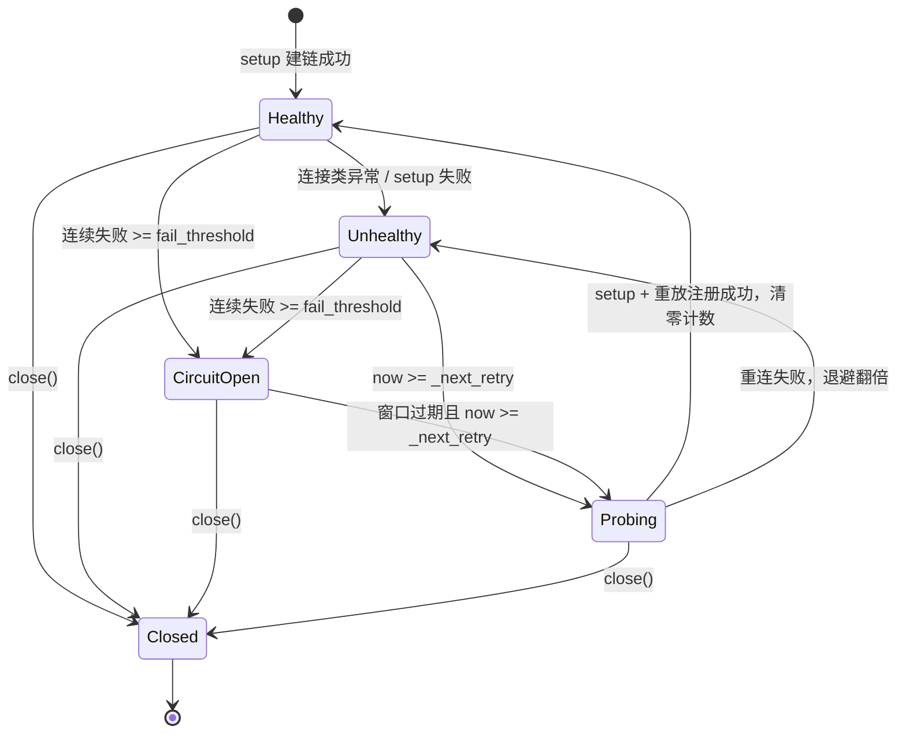

# KV Cache 池化 Store 后端设计（简版）

> 组件：`deepinfer/kv_cache/pool/backends/mooncake.py`，按架构师目录落在 `deepinfer/kv_cache/`。
> 本文覆盖 store 的「注册 / 查 / 读 / 写 + 生命周期」：把显存区域登记给 Mooncake Store，并按 key 完成存在性查询、对象写入与对象读回。
> 完整版：[kv_cache_pool_mooncake_design.md](../doc/kv_cache_pool_mooncake_design.md)；接口契约：[kv_cache_pool_interface.md](../doc/kv_cache_pool_interface.md)；上游：[DeepInfer KV Cache 池化能力设计.md](<../doc/DeepInfer KV Cache 池化能力设计.md>)（v1.0）。

---

## 1. 设计方案

### 1.1 职责划分

| 本组件（store 层） | 调用方需提供（接口前提） |
|---|---|
| `setup` / `close` / `register_buffers`：建链、注册显存区域、断连后重注册 | 完整 key 字符串（模型/权重版本 + 布局版本 + 前缀 hash + rank） |
| `exists`：逐 key 返回是否已存在 | 已 `register_buffers` 的 region，及每个对象的 `(addr, len)` 段 |
| `put` / `get`：按 `(addr, len)` 段写入/读回对象 | 共享 TE 时的 `engine` 与注册函数（独立 TE 时留空） |
| 失败降级为 `False` 返回，配合退避重连与熔断 | `required` 取值：建链失败抛错或降级（二选一） |
| 配置解析、地址对齐校验、指标出口 | `MetricsSink` exporter（可选；未注册时指标空转） |

store 的行为只取决于这五类输入；生成这些输入所需的 token / 请求 / 模型 / 调度状态都在调用方。

### 1.2 代码落点

```text
deepinfer/kv_cache/
├── protocol.py                 # Segment / BufferRegion / PutItem / GetItem
├── config.py                   # StoreConfig：role/env 映射、校验、默认 TTL
└── pool/
    ├── protocol.py             # StoreError / StoreUnavailable / MetricsSink / StoreBackend 协议
    ├── metadata.py             # block_segment / layer_ranges / layout_version / BlockLayout
    └── backends/mooncake.py    # MooncakeStoreClient：四个动词 + 生命周期 + 降级/熔断
tests/kv_cache/test_mooncake_backend.py       # FakeStore 单测（无需 Mooncake）
tests/kv_cache/test_mooncake_backend_e2e.py   # 真 Mooncake E2E（env 门控，默认 skip）
```

### 1.3 对象模型与 key

- **block 对象 = 整块单段**：一个对象是一块 `block_bytes` 的连续字节（含层内 32B pad 与块尾 padding），由 `BlockLayout.block_segment(block_id)` 生成地址。
- **SWA 对象 = `state_size_to_disk` 单段**：写源是调用方注册的 region——完整 `copy_state` 快照（首选）或 `gpu_states[state_id]` 的 stored region；调用方保证 region 已注册、快照完整，store 只按 `(addr, len)` 读写。
- **key 由调用方生成**：模型/权重版本 + 布局版本 + 前缀 hash + TP/CP/PP rank；业务隔离用 `setup(tenant_id=...)`。
- **布局版本**：优先取引擎导出的 `CacheEngine.get_kv_layout().layout_version`；引擎侧尚未提供版本串时，用本组件的 `layout_version()`（block 大小 + 层区间 + 并行拓扑的 sha1 前 12 位）作为 fallback。

### 1.4 双租户双 client

| | block 租户 | SWA 租户 |
|---|---|---|
| `role` | `block` | `swa` |
| `tenant_id` | `DEEPINFER_KV_POOL_BLOCK_TENANT` 或 `mooncake.json` | `DEEPINFER_KV_POOL_SWA_TENANT` 或 `mooncake.json` |
| soft pin | 默认开启 | 默认开启 |
| TTL | 1h（`DEEPINFER_KV_POOL_BLOCK_TTL_MS` 可覆盖） | 5min（`DEEPINFER_KV_POOL_SWA_TTL_MS` 可覆盖） |
| SSD offload | 可按需开启 | 走 memory-only |
| 纯查询 client | `contribute_memory=False` 时两项 buffer 大小传 0 | 同左 |

TransferEngine 按两条路径接入，注册动作与传输引擎保持同源：

- **共享 TE**：`StoreConfig.engine = te.get_engine()` + `_register_buffer = TE 的注册函数`。注册由调用方执行并保证幂等，buffer 注册一次；本组件负责调用与重连重放。
- **独立 TE（`engine=None`）**：`setup()` 内由 Mooncake 自建 TE，buffer 走 `store.register_buffer` 注册，注册与传输使用同一个引擎；若同时提供注入注册函数，构造期报 `ValueError`，让配置保持同源。

### 1.5 生命周期与运行期保障

```text
进程启动：setup() → register_buffers([gpu_blocks, gpu_states, (copy_state)])
运行期： exists / get / put（引擎线程与传输线程可并发调用，内部 RLock 串行化 pybind）
退出：   close() 幂等；关闭后所有动词返回 False
```

| 场景 | 行为 |
|---|---|
| `exists` 返回 `0` / `-1` | 该 key 按 miss 处理，结果为 `False` |
| `put` 返回 `0` / `-705` | 成功。`-705 = OBJECT_ALREADY_EXISTS` 按幂等成功处理，失败计数保持不变 |
| `put` 其它负返回、`get` 短读 | 该 key 结果为 `False`，调用方整体回退 |
| 连接异常 / 超时异常 | `healthy=False`，按 1s→2s→…→30s 退避重连，重连成功后重注册全部 region |
| 连续失败达到 `fail_threshold`(5) | 打开熔断窗口 `circuit_break_s`(30s)：窗口内直接返回 `False`，并按 `kv_pool_circuit_open` 上报 |
| 熔断窗口过期 | 下一次调用触发重连，连上即清零失败计数、恢复服务 |
| `setup` 失败 | `required=True` 抛 `StoreUnavailable`（启动失败可见）；`required=False` 只降级本租户池化并退避重连 |
| 调用耗时 | 由 Store 的 RPC 超时约束；连续失败由熔断兜底，buffer 在调用返回前保持有效 |

指标出口（`MetricsSink` 协议，exporter 由调用方注册）：`kv_pool_store_operation_duration_ms{op}`、`kv_pool_store_bytes_total{op}`、`kv_pool_store_failed_keys_total{op}`、`kv_pool_fail_total`、`kv_pool_circuit_open`。

> 运行期执行框架（分块 / 加锁 / 健康闸 / 降级 / 指标）见 **§2.4**，熔断与自动降级的状态机与恢复路径见 **§2.5**。

---

## 2. 伪代码

> 总览：进程生命周期与故障恢复。本章按 **配置 → 建链/注册 → 对外动词 → `_run` 执行框架 → 熔断降级 → 布局换算** 的顺序展开：先把对象建起来，再看对外接口，然后拆内部执行与失败处理，最后是地址/指纹辅助函数。



### 2.1 配置

```python
@dataclass(frozen=True)
class StoreConfig:
    role: str = "block"                      # "block" | "swa"
    tenant_id: str = "default"
    global_segment_size: int = 1 << 30       # contribute_memory=False 时 setup 传 0
    local_buffer_size: int = 1 << 30
    host_ip: str = ""                        # setup 的 local_hostname：IP 或 IP:PORT，空=Mooncake 自探测
    max_batch_keys: int = 256
    register_alignment: int = 2 << 20
    contribute_memory: bool = True
    required: bool = True                    # True：建链失败抛异常；False：本租户降级
    replica_num: int = 1
    soft_pin: bool = True                    # 池化默认开启
    soft_pin_ttl_ms: int = 0                 # 0 = 按 role 取 1h / 5min
    enable_ssd_offload: bool = False
    ssd_offload_path: str = ""
    engine: Any | None = None                # 调用方注入的 TE
    fail_threshold: int = 5
    circuit_break_s: float = 30.0
    backoff_initial_s: float = 1.0
    backoff_max_s: float = 30.0

    def __post_init__(self):
        assert role in ("block", "swa")
        assert soft_pin or not soft_pin_ttl_ms      # TTL 与 soft pin 同时配置
        if soft_pin and soft_pin_ttl_ms == 0:
            soft_pin_ttl_ms = 300_000 if role == "swa" else 3_600_000

    @classmethod
    def from_env(cls, *, contribute_memory=True, role="block"):
        raw = json.load(open(os.getenv("MOONCAKE_CONFIG_PATH"))) if os.getenv("MOONCAKE_CONFIG_PATH") else {}
        role = os.getenv("DEEPINFER_KVSTORE_ROLE", role)
        return cls(
            master_addr=os.getenv("MOONCAKE_MASTER", raw.get("master_server_address", "127.0.0.1:50051")),
            tenant_id=resolve_tenant(raw, role),             # DEEPINFER_KV_POOL_*_TENANT
            soft_pin_ttl_ms=resolve_ttl(raw, role),          # DEEPINFER_KV_POOL_*_TTL_MS
            global_segment_size=resolve_segment(raw, role),  # DEEPINFER_KV_POOL_*_SEGMENT_GB
            required=flag("DEEPINFER_KVSTORE_REQUIRED", default=True),
            ...
        )
```

### 2.2 建链 / 注册 / 关闭
建链与注册是运行期一切读写的入口：`setup()` 只做一次，`register_buffers()` 决定哪些显存可以被零拷贝读写，`close()` 之后客户端 fail-closed。

```python
def __init__(self, cfg, *, _store=None, metrics=None, _register_buffer=None):
    # 注册与传输同源：独立 TE（engine=None）时统一走 store.register_buffer
    if cfg.engine is None and _register_buffer is not None:
        raise ValueError("_register_buffer 用于共享 TE 场景，需同时设置 StoreConfig.engine")
    self.cfg, self._store, self._register_buffer = cfg, _store, _register_buffer
    self._regions = []                       # 重连后按此重注册
    self._healthy = False; self._fail_count = 0; self._circuit_open_until = 0.0

def setup(self):
    if self._store is not None:               # 单测注入 FakeStore
        self._healthy = True; return
    store = MooncakeDistributedStore()
    kwargs = dict(local_hostname=self.cfg.host_ip, metadata_server=..., protocol=...,
                  global_segment_size=self.segment if contribute_memory else 0,
                  local_buffer_size=self.buffer if contribute_memory else 0,
                  master_server_addr=..., tenant_id=...)
    if cfg.engine is not None:                # 共享 TE：复用调用方引擎
        kwargs["engine"] = cfg.engine
    if cfg.enable_ssd_offload:                # block 租户的持久层
        kwargs["enable_ssd_offload"] = True
        if cfg.ssd_offload_path:
            kwargs["ssd_offload_path"] = cfg.ssd_offload_path
    try:
        ret = store.setup(**kwargs)
    except Exception as exc:
        return self._on_setup_failure(exc)    # required=True 抛出；required=False 降级 + 退避
    if ret != 0:
        return self._on_setup_failure(StoreUnavailable(f"setup ret={ret}"))
    self._replicate = ReplicateConfig(prefer_alloc_in_same_node=...,
                                      replica_num=...,
                                      soft_pin_action=ENABLE,   # soft_pin=True
                                      soft_pin_ttl_ms=...)
    self._store = store
    self._healthy = True; self._fail_count = 0; self._circuit_open_until = 0.0

def register_buffers(self, regions):
    for r in regions:
        if r.nbytes <= 0: continue
        check_alignment(r.ptr, cfg.register_alignment)       # 未对齐抛 StoreError
        # engine 非空 → 调用方注入的 TE 注册函数；engine=None → store.register_buffer
        ret = self._register(r)
        if ret != 0: raise StoreUnavailable(...)
        self._regions.append(r)                               # 供重连后重注册

def _register(self, r):
    if self._register_buffer is not None:
        return int(self._register_buffer(r.ptr, r.nbytes))
    return int(self._store.register_buffer(r.ptr, r.nbytes))

def close(self):                             # 幂等；与在途调用互斥
    if self._closed: return
    self._closed = True; self._healthy = False
    self._store, store = None, self._store
    if store: store.close()                  # best-effort
```

`_on_setup_failure` 是 `setup()` 失败的唯一出口：

```python
def _on_setup_failure(self, exc):
    self.metrics.error("setup", exc)
    if self.cfg.required:                      # 关键路径：启动期 fail-fast
        raise StoreUnavailable(...) from exc
    self._healthy = False                      # 非关键租户：降级 + 退避重连
    self._schedule_retry()
```

### 2.3 四个动词

```python
def exists(self, keys):  return self._run("exists", len(keys), lambda idx: self._exists_chunk(keys[idx]))
def put(self, items):    return self._run("put",    len(items), lambda idx: self._put_chunk(items[idx]))
def get(self, items):    return self._run("get",    len(items), lambda idx: self._get_chunk(items[idx]))

def _exists_chunk(self, keys):
    return [int(v) == 1 for v in store.batch_is_exist(keys)]        # 1=存在；0/-1=miss

def _put_chunk(self, items):
    addrs = [[addr for addr, _ in item.segments] for item in items]
    sizes = [[nbytes for _, nbytes in item.segments] for item in items]
    res = store.batch_put_from_multi_buffers([item.key for item in items], addrs, sizes, self._replicate)
    return [int(v) in (0, -705) for v in res]                         # -705 按幂等成功

def _get_chunk(self, items):
    addrs = [[addr for addr, _ in item.segments] for item in items]
    sizes = [[nbytes for _, nbytes in item.segments] for item in items]
    res = store.batch_get_into_multi_buffers([item.key for item in items], addrs, sizes)
    return [int(v) == sum(s) for v, s in zip(res, sizes)]             # 严格等长：短读按失败
```

三个 chunk 函数的共同前提：`items` 中每个对象至少一段，地址都已 `register_buffers`；`put`/`get` 都按段序拼装/回读，`get` 用“返回字节数 == 段总长”做严格校验，避免消费半成品 KV。

> 三个动词本身都不处理失败：它们把 chunk 结果交给 §2.4 的 `_run` 统一做熔断门、健康闸、分块与降级。

### 2.4 `_run`：读写的统一执行框架

`exists` / `put` / `get` 三个动词（§2.3）都是薄壳：只把对象翻译成 Mooncake 批量 API 的参数，真正的执行逻辑集中在 `_run()`（`deepinfer/kv_cache/pool/backends/mooncake.py:247-274`）。分块、加锁、健康检查、熔断门、结果形状校验、异常降级、指标上报都只写这一处。

**契约**

- 输入：`op`（指标标签）、`count`（本批 key/对象数）、`call(idx) -> list[bool]`（单个 chunk 的实际 Mooncake 调用）；
- 输出：长度恒等于 `count` 的 `list[bool]`，失败位置为 `False`；
- **永不抛异常**：chunk 内任何异常都降级为该 chunk 的 `False`，由调用方按 miss / 重算处理。

**执行顺序（7 步）**

1. **初始化结果**：`results = [False] * count`；`count == 0` 直接返回空结果（空批次不碰 store）。
2. **熔断门**：`_circuit_open()` 为真 → 全 `False` + `metrics.error("circuit_open")`，不去撞一个已知不可用的 store。
3. **健康闸**：`_ensure_healthy()` 为假（已关闭 / 退避窗口内 / 熔断窗口内 / 重连失败）→ 全 `False`。
4. **分块**：按 `max_batch_keys`（默认 256）切 chunk，控制单次 pybind 批量调用的 key 数。
5. **调用**：`with self._io_lock: chunk = call(idx)`——RLock 只包住这一次 pybind 调用（串行化 C++ 侧），不覆盖整批与指标；随后校验 `len(chunk) == len(idx)`，不符抛 `StoreError`；再逐位写回结果并 `_fail_count = 0`（成功即清零连续失败）。
6. **异常降级**：`except Exception` → `_on_error(op, exc)`，该 chunk 保持 `False`；**继续下一个 chunk**（chunk 之间互相独立，允许部分成功）。
7. **指标**：`finally` 中 `metrics.observe(op, len(idx), 耗时)`，成功失败都上报耗时/流量。

**关键取舍**

- 锁粒度 = 单 chunk：同一 client 的 pybind 调用串行，但 chunk 之间允许其他线程插入；吞吐靠多进程 / 多 rank，不靠单连接多线程；
- 逐 key 返回码（`exists` 的 `0/-1`、`put` 的 `-705` 等）的归一在 `_chunk` 层完成，`_run` 只消费 `bool`；
- 返回形状不符视为异常（保护“结果与输入一一对应”），会计入失败计数；
- `observe` 在 `finally`：失败也计时；当前指标出口不带字节数（见 §2.5 指标映射与已知限制）。

```python
def _run(self, op, count, call):
    results = [False] * count
    if count == 0:                                  # 空批次：直接返回
        return results
    if self._circuit_open():                        # 熔断窗口：快速 miss
        self.metrics.error("circuit_open", StoreUnavailable("熔断窗口内跳过 store 调用"))
        return results
    if not self._ensure_healthy():                  # 已关闭 / 退避 / 重连失败
        return results
    for start in range(0, count, self.cfg.max_batch_keys):
        idx = range(start, min(start + self.cfg.max_batch_keys, count))
        began = time.perf_counter()
        try:
            with self._io_lock:                     # 仅串行化这一次 pybind 调用
                chunk = call(idx)
            if len(chunk) != len(idx):              # 结果必须与输入一一对应
                raise StoreError(f"{op} 返回 {len(chunk)} 个结果，期望 {len(idx)} 个")
            for result_index, value in zip(idx, chunk, strict=True):
                results[result_index] = bool(value)
            self._fail_count = 0                    # 成功清零连续失败
        except Exception as exc:                    # 传输异常降级成 miss，不抛进引擎
            self._on_error(op, exc)
        finally:
            self.metrics.observe(op, len(idx), time.perf_counter() - began)
    return results
```

**流程图**



### 2.5 熔断与自动降级

状态机由 `_run`（§2.4）在每次 chunk 结束时驱动、由 `_ensure_healthy()` 在每次调用前检查。运行期失败分两类，处理方式完全不同：

| 失败类型 | 例子 | 返回 | 对健康/熔断的影响 |
|---|---|---|---|
| 逐 key 业务失败 | `exists` 返回 `0/-1`、`put` 其它负返回、`get` 短读 | 该 key `False`，其余 key 不受影响 | **不影响** `_healthy`，不计失败（`-705` 反而按成功清零） |
| chunk 级异常 | 连接/超时、`StoreError`（形状不符等）、pybind 抛错 | 该 chunk 全 `False` | 进 `_on_error`：连接类立即 unhealthy；所有异常累计连续失败 |

**四个状态变量**（都在 client 实例上，per-client 隔离）

| 变量 | 含义 |
|---|---|
| `_healthy` | 本 client 当前能否直接调 store |
| `_fail_count` | 连续失败次数（成功的 chunk 清零） |
| `_circuit_open_until` | 熔断窗口截止时间（`now < 它` → 窗口内） |
| `_backoff` / `_next_retry` | 下一次允许重连试探的时间与指数退避步长（1s→30s） |

**退避 vs 熔断（两个容易混的机制）**

- **退避**：控制“什么时候允许试探重连”。连接类异常 → `_healthy=False` + `_next_retry = now + backoff`；每次失败 `backoff *= 2`（封顶 30s），到点后由下一次调用触发重连；
- **熔断**：控制“连续失败太多时强制冷却”。`_fail_count >= fail_threshold`(5) → 打开 `circuit_break_s`(30s) 窗口；**窗口内连试探都不做**，所有动词直接 `False`，避免每个请求都撞一个已知挂掉的 store；
- 叠加关系：`_ensure_healthy()` 同时检查 `_circuit_open()` 与 `now < _next_retry`，任一为真就快速失败；窗口到期后的第一次调用才会尝试 `setup()`。

**`_on_error` 的处理链**（`mooncake.py:276-290`）

1. `metrics.error(op, exc)`：记录失败事件（对应 `kv_pool_fail_total`）；
2. 若是连接类异常（`TimeoutError` / `ConnectionError` / `StoreUnavailable`）→ 立即 `_healthy=False` + `_schedule_retry()`（进入退避）；
3. `_record_failure()`：`_fail_count += 1`；达到阈值 → `_healthy=False`、`_circuit_open_until = now + circuit_break_s`、`metrics.error("circuit_open", exc)`（对应 `kv_pool_circuit_open`）。

**恢复路径**（`_ensure_healthy`，`mooncake.py:300-326`）

1. 已关闭 → `False`（close 后永久 fail-closed）；
2. 已健康 → `True`；
3. 熔断窗口内或 `now < _next_retry` → `False`（快速失败）；
4. 否则 `setup()` 重建链路（`required` 语义在这里生效：`required=False` 时 setup 内部只降级 + 排退避，不抛），再按 `_regions` **重放全部 buffer 注册**；
5. 成功：`_fail_count = 0`、`_next_retry = 0`，服务恢复；失败：计失败 + 重排退避，返回 `False`。

**参数与覆盖**

| 参数 | 默认 | 覆盖方式 |
|---|---|---|
| `fail_threshold` | 5 | `DEEPINFER_KVSTORE_FAIL_THRESHOLD` / json `fail_threshold` |
| `circuit_break_s` | 30 | `DEEPINFER_KVSTORE_CIRCUIT_BREAK_S` / `DEEPINFER_KV_POOL_CIRCUIT_BREAK_S` |
| `backoff_initial_s` | 1 | `StoreConfig` 字段（暂无 env） |
| `backoff_max_s` | 30 | `StoreConfig` 字段（暂无 env） |

**状态机**



> 说明：`Unhealthy` 表示 `_healthy=False` 且处于退避/熔断等待；`Probing` 是 `_ensure_healthy()` 正在重连的瞬时状态，成功回 `Healthy`、失败回 `Unhealthy`（退避翻倍）。`CircuitOpen` 窗口内所有动词直接返回 `False`，不发任何 store 调用。

**已知限制与取舍**

- 熔断、退避都是 **per-client** 的，不是全局：block/SWA 两个 client 互不影响；
- 熔断窗口固定 `circuit_break_s`，不做随机抖动（多实例同时恢复可能带来瞬时压力，属可接受设计）；
- 连续失败按 chunk 计：同一批里后一个 chunk 成功会把 `_fail_count` 清零（语义是“连续失败”，不是“累计失败”）；
- 代码 bug（`TypeError` 等）也会被兜底成 `False` 并计入熔断——这是“不把异常抛进引擎”的代价，属已知限制；
- 指标映射：`kv_pool_fail_total` ← `_record_failure`；`kv_pool_circuit_open` ← exporter 轮询 `client.circuit_open` 属性；`error("circuit_open"/"setup"/"reconnect")` 是对应事件。

### 2.6 布局换算

```python
def layer_ranges(ce):                     # 保留 kv_length > 0 的层
    return [(off, n) for _, off, n in ce.kvcache_layout if n > 0]

def block_segment(blocks_ptr, block_bytes, block_id):     # 池化对象：整块单段
    return ((blocks_ptr + block_id * block_bytes, block_bytes),)

def state_segments(states_ptr, bytes_per_state, state_id, nbytes):  # SWA 对象：单段
    return () if nbytes <= 0 else ((states_ptr + state_id * bytes_per_state, nbytes),)

def layout_version(block_bytes, ranges, *, tp=1, cp=1, pp=1, extra=""):
    # fallback：优先使用引擎导出的 ce.get_kv_layout().layout_version
    return sha1(f"{block_bytes}|{ranges}|tp={tp};cp={cp};pp={pp};{extra}").hexdigest()[:12]
```

---

## 3. 测试用例

### 3.1 单测（FakeStore 注入，无需 Mooncake / NPU）

文件：[tests/kv_cache/test_mooncake_backend.py](../tests/kv_cache/test_mooncake_backend.py)

| 编号 | 场景 | 断言 |
|---|---|---|
| U-01 | 多段拼装与回读顺序 | `put`/`get` 返回 True，目标段逐字节等于源段 |
| U-02 | 逐 key 失败 | 失败 key 为 False，其余 key 保持成功 |
| U-03 | 整批异常 / 返回形状不符 | 该 chunk 全 False，结果长度与输入一致 |
| U-04 | 短读 | `get` 返回字节数小于段总长 → 该 key 为 False |
| U-05 | `-705` 幂等 | `put` 返回 `-705` → True；失败计数保持为 0 |
| U-06 | `healthy=False` / `close()` | 所有动词返回 False 且不再调用 store；`close` 幂等 |
| U-07 | 断连退避与重连 | 退避窗口内直接返回 False；到点重连并自动重注册全部 buffer |
| U-08 | 熔断 | 连续失败达 `fail_threshold` 后窗口内不调用 store；窗口过期重连成功，`healthy=True`、`circuit_open=False` |
| U-09 | `required=False` 降级 | `setup` 失败后 `healthy=False`，后续 `exists` 返回 False，进程继续运行 |
| U-10 | 对齐校验 | 未按 `register_alignment` 对齐 → `StoreError`；`nbytes<=0` 跳过 |
| U-11 | `ReplicateConfig` 映射 | 默认 `soft_pin_action=ENABLE`、block TTL=1h、SWA TTL=5min；显式值优先；`soft_pin=False` 时不设置 ENABLE |
| U-12 | 池化 env 映射 | `DEEPINFER_KV_POOL_{BLOCK,SWA}_TENANT/_TTL_MS/_SEGMENT_GB` 按 role 落到配置 |
| U-13 | `engine` / `ssd_offload_path` 透传 | 配置非空时 `setup` kwargs 中出现对应字段 |
| U-14 | 共享 TE 注册注入 | `engine` 非空 + 注入 `_register_buffer` → 走注入函数、不再调 `store.register_buffer`，buffer 注册一次 |
| U-15 | 布局换算 | `layer_ranges` 保留正长度层；`block_segment` 整块单段；`state_segments` 越界抛错；`layout_version` 吸收并行拓扑 |
| U-16 | 配置校验 | role 非法、TTL 与 soft_pin 冲突、`fail_threshold<=0`、退避参数非法 → `ValueError` |
| U-17 | `engine` / 注册函数组合校验 | `engine=None` 时注入 `_register_buffer` → `ValueError`；`engine=None` 默认走 `store.register_buffer` 并登记地址 |

### 3.2 E2E（真 Mooncake，默认 skip）

文件：[tests/kv_cache/test_mooncake_backend_e2e.py](../tests/kv_cache/test_mooncake_backend_e2e.py)；前置：`mooncake_master` + `MOONCAKE_MASTER=127.0.0.1:50051` + `DEEPINFER_KVSTORE_E2E=1`。

| 编号 | 场景 | 断言 |
|---|---|---|
| E-01 | 注册→put→exists→get | 全链路 True；读回与写入逐字节一致 |
| E-02 | 跨实例命中 | 实例 1 写入退出，实例 2 新起后 `exists/get` 命中 |
| E-03 | 部分命中 | 缺失 key 为 False，存在项保持命中 |
| E-04 | 整块单段 roundtrip | `put` 整块 `block_bytes`（含 padding）→ `get` 后逐字节相同，对象大小 == `block_bytes` |
| E-05 | SWA 单段 roundtrip | `state_size_to_disk` 单段读写一致 |
| E-06 | 重复写幂等 | 同 key 再写 payload B → `put` True；读回仍为 payload A；失败计数保持为 0 |
| E-07 | 断连与恢复 | kill master 期间全部 False、调用快速返回；重启后自动重连并重新命中 |
| E-08 | 多租户隔离 | block / SWA 两个 client：各自租户内命中；跨租户同 key 命中为 False；未注册租户写入按 miss 处理 |
| E-09 | 双 client 共享 TE | 注入同一个 `engine` + `_register_buffer`：两个 client 都 setup 成功、读写互不干扰 |
| E-10 | 多 rank 分片 | CP=2 两进程各写各的对象，命中长度一致 |

### 3.3 验收命令

```bash
# 单测（无需 Mooncake，CI 必跑）
python -m pytest -v -s tests/kv_cache/test_mooncake_backend.py

# 真机 E2E（默认 skip，需要 master 与 mooncake wheel）
DEEPINFER_KVSTORE_E2E=1 python -m pytest -v -s tests/kv_cache/test_mooncake_backend_e2e.py

# 代码规范
python -m ruff format --check deepinfer/kv_cache tests/kv_cache
python -m ruff check deepinfer/kv_cache tests/kv_cache
```

> 输出一致性（逐 token / PPL）由上层验收流程按上游文档 §11.0 分级验收；本组件负责对象字节读写正确与调用面稳定。