# vLLM 异步 KV Get（远端 prefix 加载）全链路梳理

本文只基于 vLLM 代码仓，梳理 V1 引擎中「外部 KV 前缀命中 → 异步 Get 下发 → 跨 rank 聚合 → 调度器应用完成 → 恢复 Prefill」的完整流程，包含涉及的类/组件、调用方法与关键状态流转。具体实现统一以仓库内的 `MooncakeStoreConnector`（共享 KV Pool，最贴近 Store get 场景）为例。

代码基线：`/Users/l/L/Code/TuringProject/D/vllm`（仅此仓库）。

---

## 1. 参与组件

### 1.1 通用框架层

| 组件                                          | 位置                                                     | 职责                                                              | 关键方法                                                                                                                                                                                                                                                               |
| --------------------------------------------- | -------------------------------------------------------- | ----------------------------------------------------------------- | ---------------------------------------------------------------------------------------------------------------------------------------------------------------------------------------------------------------------------------------------------------------------- |
| `EngineCore`                                | `vllm/v1/engine/core.py`                               | 单步编排：调度 → 执行 → 应用输出                                | `step()`（:713）、`_process_engine_step()`（:1855）                                                                                                                                                                                                                |
| `Scheduler`                                 | `vllm/v1/core/sched/scheduler.py`                      | 命中接纳、队列管理、额度控制、完成态应用                          | `schedule()`、`update_from_output()`、`_handle_blocked_waiting_request()`（:3668）、`_update_from_kv_xfer_finished()`（:3706）、`_update_waiting_for_remote_kv()`（:3616）、`_admits_inflight_kv_load()`（:2842）、`_enqueue_waiting_request()`（:2777） |
| `SchedulerOutput`                           | `vllm/v1/core/sched/output.py`                         | 交给 worker 的调度结果                                            | `kv_connector_metadata`（:278）、`has_sync_kv_loads`、`finished_req_ids`、`preempted_req_ids`                                                                                                                                                                  |
| `MultiprocExecutor`                         | `vllm/v1/executor/multiproc_executor.py`               | 广播 `execute_model` 到所有 worker，回收并聚合输出              | `collective_rpc()`（:471）、`_aggregate()`（:498）                                                                                                                                                                                                                 |
| `KVOutputAggregator`                        | `vllm/distributed/kv_transfer/kv_connector/utils.py`   | 跨 worker/rank 聚合 `KVConnectorOutput`                         | `from_connector()`（:79）、`aggregate()`（:82）、`ft_defer_kv_connector_outputs()`（:202）                                                                                                                                                                       |
| `KVConnectorBase_V1`                        | `vllm/distributed/kv_transfer/kv_connector/v1/base.py` | connector 统一接口（scheduler / worker 双角色）                   | `get_num_new_matched_tokens()`、`update_state_after_alloc()`、`build_connector_meta()`、`start_load_kv()`（:340）、`get_finished()`（:405）、`get_transfer_results()`、`get_finished_count()`（:750）、`update_connector_output()`                     |
| Worker 侧门面 `KVConnector`                 | `vllm/v1/worker/gpu/kv_connector.py`                   | 绑定元数据、触发 load、收集结果                                   | `pre_forward()`（:75）、`_start_load_kv()`（:118）、`post_forward()`（:133）、`no_forward()`（:168）                                                                                                                                                           |
| `GPUModelRunner`                            | `vllm/v1/worker/gpu/model_runner.py`                   | 执行 forward，把 `KVConnectorOutput` 挂到 `ModelRunnerOutput` | `execute_model()`（:2307、:2414 调用 `post_forward`）、`no_forward` 分支（:1841、:1898）                                                                                                                                                                         |
| `ModelRunnerOutput` / `KVConnectorOutput` | `vllm/v1/outputs.py`                                   | worker → engine 的结果载体                                       | `KVConnectorOutput`（:215）：`finished_sending`、`finished_recving`、`failed_recving`、`invalid_block_ids`、`expected_finished_count`、`is_empty()`                                                                                                      |

> 其他 connector 实现（`nixl/`、`lmcache_connector.py`、`mooncake/mooncake_connector.py` 等）共享同一套框架接口，只需替换 §1.2 的 scheduler / worker 子类。

### 1.2 仓库内 Store 型实现：MooncakeStoreConnector

| 组件                                                 | 位置                                       | 职责                                                           | 关键方法                                                                                                                                                                                                                                                                                                                   |
| ---------------------------------------------------- | ------------------------------------------ | -------------------------------------------------------------- | -------------------------------------------------------------------------------------------------------------------------------------------------------------------------------------------------------------------------------------------------------------------------------------------------------------------------- |
| `MooncakeStoreConnector`                           | `.../v1/mooncake/store/connector.py:129` | 对外 connector 门面，按 role 实例化 scheduler / worker         | `on_new_request()`（:241）、`get_num_new_matched_tokens()`（:245）、`update_state_after_alloc()`（:255）、`build_connector_meta()`（:274）、`start_load_kv()`（:382）、`wait_for_save()`（:402）、`get_finished()`（:408）、`get_transfer_results()`（:416）、`get_block_ids_with_load_errors()`（:424） |
| `MooncakeStoreScheduler`                           | `.../store/scheduler.py:124`             | 命中查询、生成 load 计划、生成下发元数据                       | `bind_gpu_block_pool()`（:205）、`start_lookup_prefetch()`（:215）、`get_num_new_matched_tokens()`（:230）、`update_state_after_alloc()`（:282）、`build_connector_meta()`（:322）                                                                                                                               |
| `LookupKeyClient`                                  | `.../store/worker.py:2803`               | 异步命中查询（线程池 + key server）                            | `lookup()`（可返回未完成）、`prefetch()`、`discard()`                                                                                                                                                                                                                                                                |
| `LoadSpec`                                         | `.../store/data.py:222`                  | 单请求的加载计划                                               | `vllm_cached_tokens`、`kvpool_cached_tokens`、`can_load`、`token_len`、`tail_key_boundaries`                                                                                                                                                                                                                     |
| `ReqMeta`                                          | `.../store/data.py:275`                  | 下发给 worker 的单请求任务                                     | `req_id`、`block_ids`、`block_hashes`、`load_spec`、`can_save`、`store_job_id`                                                                                                                                                                                                                                 |
| `MooncakeStoreConnectorMetadata`                   | `.../store/data.py:413`                  | 一整个 step 的任务集合                                         | `add_request()`、`requests`、`unfinished_request_ids`                                                                                                                                                                                                                                                                |
| `MooncakeStoreWorker`                              | `.../store/worker.py:1496`               | 每 rank worker：提交加载、收集完成                             | `start_load_kv()`（:2296）、`wait_for_save()`（:2319）、`get_finished()`（:2338）、`get_transfer_results()`（:2374）、`build_connector_worker_meta()`（:2452）、`get_block_ids_with_load_errors()`（:2368）                                                                                                    |
| `KVTransferThread` / `KVCacheStoreRecvingThread` | `.../store/worker.py:432` / `:1217`    | 后台线程：`store.get` 到目标 block，发布完成/失败/非法 block | `add_request()`（:459 基类）、`_handle_request()`（:1292）、`get_and_clear_finished_requests()`（:462）、`set_finished_request()`（:468）、`get_and_clear_failed_requests()`、`get_and_clear_block_ids_with_load_errors()`                                                                                     |
| `MooncakeDistributedStore`                         | 外部库（`store` 字段）                   | 实际字节读写（RDMA）                                           | `batch_get`、`register_buffer` 等                                                                                                                                                                                                                                                                                      |

接收线程数量由 `envs.VLLM_MOONCAKE_LOAD_RECV_THREADS` 决定，所有接收线程共享同一个 `recv_request_queue`（`worker.py:1675-1676`、`:2254-2279`）。

---

## 2. 组件分层总览

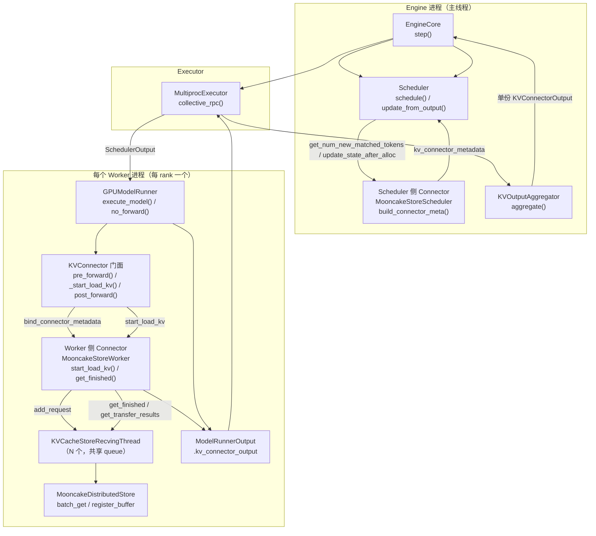

---

## 3. 单步全链路时序

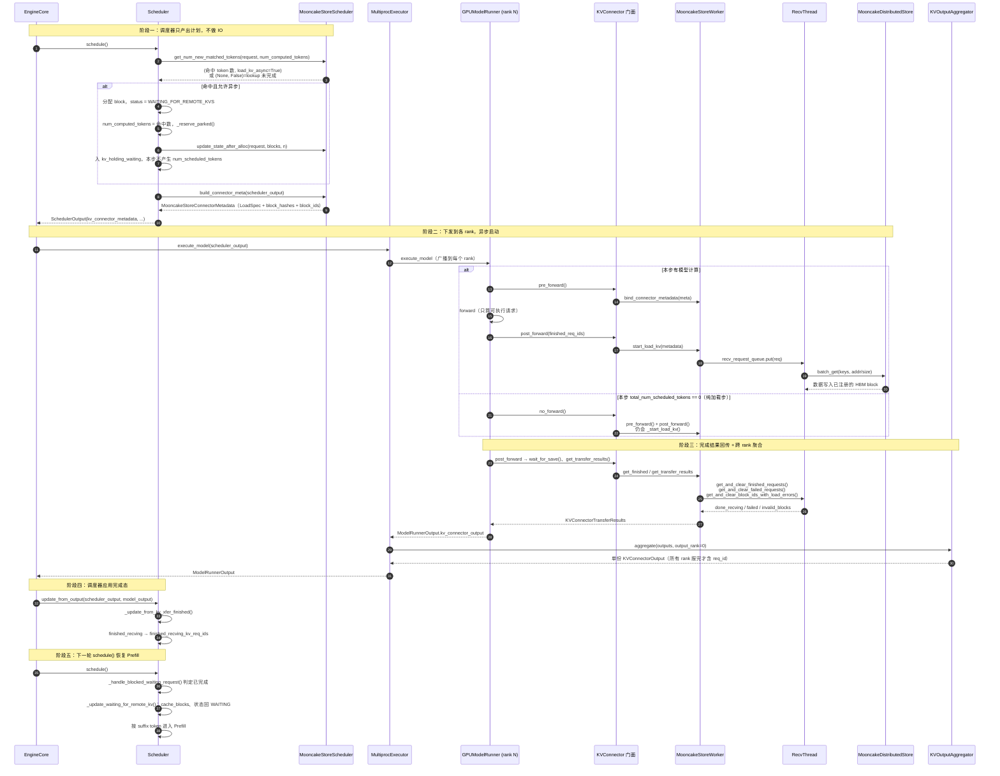

关键点：

1. **调度器只产出元数据**：`get_num_new_matched_tokens()` / `update_state_after_alloc()` / `build_connector_meta()` 都在 `schedule()` 内完成，全程不碰 Store（`scheduler.py:1177`、`:1544`、`:1812`）。
2. **命中查询本身也可能异步**：`on_new_request()` 触发 `start_lookup_prefetch()`，`get_num_new_matched_tokens()` 在结果未就绪时返回 `(None, False)`，调度器本轮跳过该请求、后续轮次重试（`store/scheduler.py:215-250`）。
3. **异步 Get 在 forward 之后提交**：`pre_forward()` 只 `bind_connector_metadata()`；同步 load 才在本步 forward 前 `_start_load_kv()`，异步 load 由 `post_forward()` 触发，避免占用 forward 关键路径（`gpu/kv_connector.py:75-97`、`:140-141`）。
4. **纯加载步也走完整链路**：当本步没有可算 token（`total_num_scheduled_tokens == 0`）时，`no_forward()` 仍执行 `pre_forward → post_forward`，保证 load 提交与结果收集不断链（`model_runner.py:1839-1842`、`kv_connector.py:168-181`）。
5. **完成态随本轮模型输出回到调度器**：结果挂在 `ModelRunnerOutput.kv_connector_output`（`model_runner.py:2307`），在同一次 `update_from_output()` 中应用（`core.py:737`），不是下一轮 step 开头再轮询。

---

## 4. 调度器侧：队列模型与接纳决策

### 4.1 等待队列语义

| 队列                   | 语义                                                            | 对应 REQ-KVP-04 概念           |
| ---------------------- | --------------------------------------------------------------- | ------------------------------ |
| `waiting`            | 普通等待请求                                                    | 普通 `waiting`               |
| `async_kv_waiting`   | 有外部命中能力、**尚未开始**异步 load 的请求（用于限流）  | 待提交 Get 的 `waiting` 子集 |
| `kv_holding_waiting` | **已持有 KV block** 的请求，含 `WAITING_FOR_REMOTE_KVS` | `kv_loading` + `kv_ready`  |
| `deferred_waiting`   | 本轮被跳过的请求暂存，用于恢复顺序                              | —                             |

「load 中」与「load 完成待重调度」用两个标记区分：`Request.status == WAITING_FOR_REMOTE_KVS` 与集合 `finished_recving_kv_req_ids`。后者即 `kv_ready` 的等价物。

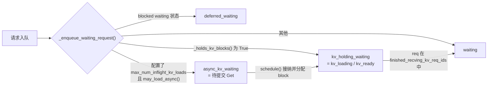

代码：`_enqueue_waiting_request()`（`scheduler.py:2777`）、`_is_blocked_waiting_status()`（`:2755`）、`_holds_kv_blocks()`（`:2766`）。

### 4.2 `schedule()` 内的选择顺序

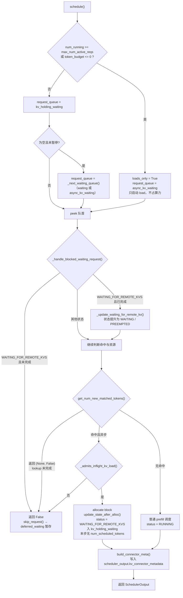

对应代码：`scheduler.py:1060-1120`（队列选择）、`:1177`（命中查询）、`:1325`（额度）、`:1529-1607`（异步接纳）。

### 4.3 inflight 额度

```python
# scheduler.py:2842
def _admits_inflight_kv_load(self) -> bool:
    limit = self.scheduler_config.max_num_inflight_kv_loads
    return limit is None or (
        self._kv_fetch_counts[KV_FETCH_IN_PROGRESS]      # 传输中
        + self._kv_fetch_counts[KV_FETCH_COMPLETED_WAITING]  # 已完成但未调度
        + len(self._aborted_kv_loads)                    # 已取消但可能仍在途
        < limit
    )
```

阶段由 `_set_kv_fetch_stage()` 维护，取值为 `KV_FETCH_WAITING_TO_START / KV_FETCH_IN_PROGRESS / KV_FETCH_COMPLETED_WAITING`（`scheduler.py:1599-1607`、`:3725`）。

---

## 5. 多 rank 的 forward 输出如何合并

结论：**模型输出不做"拼接"**。一个 batch 的 `ModelRunnerOutput` 只由唯一一个指定 rank 返回；唯一跨 rank 合并的东西是 `KVConnectorOutput`，合并方式是"计数收敛 + 并集"，也不是拼接。

### 5.1 指定返回 rank：`output_rank`

```python
# vllm/v1/executor/multiproc_executor.py:683
def _get_output_rank(self) -> int:
    # Only returns ModelRunnerOutput from TP rank=0 and PP rank=-1
    # (the first TP worker of the last PP stage).
    return (
        self.world_size
        - self.parallel_config.tensor_parallel_size
        * self.parallel_config.prefill_context_parallel_size
    )
```

- 即 **最后一个 PP stage 的第一个 TP worker**（TP=8、PP=4、world=32 时为 rank 24）。
- 原因：TP 切的是权重/head，各 rank 内部 all-reduce / all-gather 后 logits 一致，任一 TP rank 的结果等价；PP 只有最后一个 stage 有 logits，所以必须取最后一级。
- DP 的 `world_size_across_dp = world_size * data_parallel_size`（`config/parallel.py:702`），每个 DP rank 是独立 batch / 独立调度副本，不在同一个 executor 内合并。

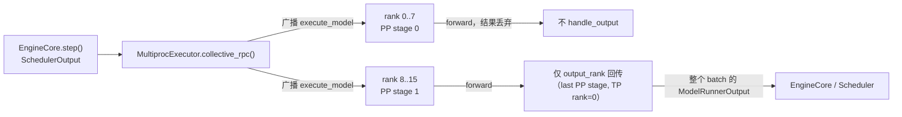

对应代码：`execute_model()`（`multiproc_executor.py:430-441`，传 `unique_reply_rank=self.output_rank`）、worker 侧只让 `self.rank == output_rank` 回传（`:1217-1227`）。**其余 rank 的 forward 结果连序列化都不做，直接丢弃。**

### 5.2 有 KV connector 时：所有 rank 都回传，再由聚合器合并"完成通知"

一旦传入 `kv_output_aggregator` / `ec_output_aggregator`，`collective_rpc` 会把 `output_rank` 置为 `None`（`multiproc_executor.py:493-496`），于是**所有 rank 都回传** `ModelRunnerOutput`；随后 `_aggregate()` 以指定 rank 的输出为基底，依次让每个聚合器原地合并自己的字段（`:498-507`）：

```python
rank = unique_reply_rank or 0
result = outputs[rank]
for a in aggregators:
    result = a.aggregate(outputs, output_rank=rank)
```

所以调度器拿到的仍然是**一份** `ModelRunnerOutput`：token 类字段来自指定 rank，`kv_connector_output` 字段是多 rank 合并结果。

| 字段 | 数据来源 | 合并方式 |
| --- | --- | --- |
| `req_ids`、`sampled_token_ids`、`logprobs`、`pooler_output`、`num_nans_in_logits` | `output_rank` | 不合并，取单一 rank |
| `kv_connector_output.finished_recving` / `finished_sending` | 全 rank | **计数收敛**：每个 rank 报一次，全部报完才进入结果集 |
| `kv_connector_output.invalid_block_ids` | 全 rank | 并集 |
| `kv_connector_output.failed_recving` | 全 rank | 需与 `finished_recving` 同时出现才判定为最终失败 |
| `kv_connector_output.kv_connector_stats` | 全 rank | `KVConnectorStats.aggregate()` |
| `kv_connector_output.kv_cache_events` | 全 rank | `add_events()` + `increment_workers()` |
| `kv_connector_output.kv_connector_worker_meta` | 全 rank | `aggregate()` |
| `ec_connector_output` | 全 rank | `ECOutputAggregator`，同上 |

注意：跨 rank 流动的只是**完成通知 / 失败标记**，KV 数据本身不会被搬到某个 rank 上再合并——每个 rank 只往自己的 HBM block 写自己那份 shard。

### 5.3 一个例子（TP=4、PP=2，共 8 个 worker，请求 r1 命中 3 个 block）

1. 8 个 worker 都收到同一个 `SchedulerOutput` 并各自 forward；只有 rank 4（8 − 4 = 4，最后一个 PP stage 的首个 TP worker）回传模型输出。
2. 各 rank 的 worker connector 各自执行自己那份 Get，完成后各自在本地 `KVConnectorOutput.finished_recving` 里写 `{r1}`。
3. `KVOutputAggregator` 的期望计数默认是 `world_size`（`executor/abstract.py:375-378`），因此 r1 要等 8 份通知都到齐才进入合并结果的 `finished_recving`。
4. 调度器只看到 `{r1}` 一次，转成 `finished_recving_kv_req_ids`，下一轮 `schedule()` 才提升状态；不会因为"8 个 rank 各报一次"而重复调度。

> 这也解释了一个实现约束：**即使某个 rank 本地 shard 为空，也必须上报完成**，否则计数永远收敛不到 0（NIXL 的注释明确写了这一点：`nixl/pull_worker.py:208`）。

### 5.4 当前 step 聚合的到底是哪一步的请求

`post_forward()` 的执行顺序是「先提交、后收集」（`gpu/kv_connector.py:133-160`）：

| 顺序 | 动作 | 代码 | 对本步聚合结果的贡献 |
| --- | --- | --- | --- |
| 1 | `_start_load_kv()` 提交**本步新建**的异步 Get | `:140-141` | 无。刚入队，recv 线程几乎不可能在同一时刻已回 |
| 2 | `wait_for_save()` 等本轮 put | `:143-144` | 无（只影响 `finished_sending`） |
| 3 | `get_transfer_results(finished_req_ids)` 取本 rank 已完成集合 | `:145` | **本步聚合的输入**：到此刻为止已完成的增量 |
| 4 | executor 聚合所有 rank 的增量 | `multiproc_executor.py:498-507` | 输出：到本步为止「全 rank 都确认」的 req |

所以：

- **输入是"本步各 rank 的增量上报"**；因为异步 Get 在本步末尾才提交，这些增量通常对应**之前 step 提交、到现在才完成**的任务。
- **完成判定是跨 step 的**：聚合器里保存 `_recv_remaining_count[req_id]`（还差几个 rank 没报），一个请求可能在第 T 步提交、第 T+2 步才因最后一份通知到齐而被宣布完成。
- `get_transfer_results(finished_req_ids)` 的 `finished_req_ids` 是**生成已结束**的请求集合（用于收尾 send/store 任务），与 KV Get 完成无关。

以 TP=4（4 个 rank）为例：

```text
step T     : schedule 接纳 r1（WAITING_FOR_REMOTE_KVS）；post_forward 在 4 个 rank 提交 Get；收集到 ∅
step T+1   : rank0/rank1 报 r1；聚合后 finished_recving=∅（_recv_remaining_count[r1]=2）
step T+2   : rank2/rank3 报 r1；计数归 0 → finished_recving={r1} → 调度器下一步提升状态
```

### 5.5 聚合器那段代码逐行说明

```python
# multiproc_executor.py:493-510
aggregators = [a for a in (kv_output_aggregator, ec_output_aggregator) if a]
if aggregators:
    output_rank = None                      # ①
    def _aggregate(outputs: Any) -> Any:    # outputs 按 rank 顺序排列
        rank = unique_reply_rank or 0       # ②
        result = outputs[rank]              # ③
        for a in aggregators:               # ④
            result = a.aggregate(outputs, output_rank=rank)
        return result                       # ⑤
    aggregate = _aggregate
else:
    output_rank = unique_reply_rank         # 没有聚合器：只有指定 rank 回传
    aggregate = lambda x: x
```

① `output_rank = None` 有**两个作用**：worker 侧判断 `if output_rank is None or self.rank == output_rank`（`:1217`）于是**所有 rank 都回传**；主进程侧 `response_mqs = self.response_mqs` 不收窄（`:518-520`），把所有 rank 的结果都收上来。`response_mqs` 是按 `range(world_size)` 建表的（`:274-287`），所以 `responses[i]` 就是 rank i 的输出。

② `rank` 是指定返回 rank（`_get_output_rank()`，最后一个 PP stage 的首个 TP worker）；`or 0` 只是兜底。

③ `outputs[rank]` 是**基底**：token / logprobs / req_ids 等模型字段只信这一份，不合并。

④ 链式调用能成立，是因为每个聚合器**只写自己负责的字段**（`kv_connector_output` 与 `ec_connector_output`），并且都是**原地改写 `outputs[rank]` 后返回同一个对象**（`utils.py:186-200`）。所以第二个聚合器拿到的 `result` 仍是同一个 `ModelRunnerOutput`，只是前一个字段已被替换。

⑤ 最终返回**一份** `ModelRunnerOutput`：模型字段来自指定 rank，connector 字段是合并结果。调度器完全看不到多 rank 的存在。

聚合器内部的状态（`KVOutputAggregator`，`utils.py:68-76`）：

```python
self._recv_remaining_count: dict[str, int]   # req_id -> 还差几个 rank 报
self._send_remaining_count: dict[str, int]
self._failed_recving_pending: set[str]
self._expected_finished_count                # 默认 world_size，connector 可覆盖
```

```python
# utils.py:90-102
def update_finished_set(req_ids, remaining_count_dict, finished_set):
    for req_id in req_ids or ():
        remaining = remaining_count_dict.get(req_id, self._expected_finished_count)
        remaining_count_dict[req_id] = remaining - 1
        if remaining_count_dict[req_id] == 0:   # 最后一个 rank 报到
            finished_set.add(req_id)
            del remaining_count_dict[req_id]    # 删掉后再来的重复上报会从 N-1 重新开始，永远收敛不到 0
```

即：**按 req_id 做分布式 ack 计数**，同一方向（send / recv）每个 rank 只能报一次；重复上报天然失效。`invalid_block_ids` 走并集，`failed_recving` 要求同 req 也出现在 `finished_recving` 中，才算最终失败。

### 5.6 各 rank 返回的 req_id 集合不一样怎么办

不需要"对齐集合"。聚合器是**逐个 rank、逐个 req 地递减同一个全局计数器**（`utils.py:120-142`）：

```python
for kv_output in chain(salvaged, kv_outputs):        # 每个 rank 的 KVConnectorOutput
    update_finished_set(kv_output.finished_sending, self._send_remaining_count, finished_sending)
    update_finished_set(kv_output.finished_recving, self._recv_remaining_count, finished_recving)
```

因此：

- `_recv_remaining_count` 是 **`req_id -> 还差几次 ack`** 的全局字典（不区分 rank），某个 req 只在部分 rank 的集合里出现时，就只那几次递减，别的 req 走自己的计数器，互不影响。
- 遍历顺序不影响结果（单调递减），所以"rank0 先报、rank1 后报"与顺序无关。
- 语义等价于**各 rank 上报集合的交集**（严格说要 ack 满 `expected_finished_count` 次），**不是并集**——并集会导致只被部分 rank 加载完的请求被提前宣布完成。

例子（4 个 rank，`expected_finished_count=4`）：

| 时间 | rank0 | rank1 | rank2 | rank3 | 计数变化 | 本步输出 |
| --- | --- | --- | --- | --- | --- | --- |
| step T+1 | {r1} | {r1, r2} | ∅ | {r2} | r1: 4→2，r2: 4→2 | ∅ |
| step T+2 | ∅ | {r2} | {r1, r2} | {r1} | r1: 2→0（满 4 次）<br/>r2: 2→1 | `finished_recving={r1}` |
| step T+3 | {r2} | ∅ | ∅ | ∅ | r2: 1→0 | `finished_recving={r2}` |

两个工程约束：

1. **必须每个 rank 都上报**，否则计数器永远不为 0，请求会卡在 `WAITING_FOR_REMOTE_KVS`（空 shard 也要报，见 `nixl/pull_worker.py:208`）。
2. **期望次数可被覆盖或动态调整**：connector 可实现 `get_finished_count()` 返回更小的值（例如 `ExampleHiddenStatesConnector` 返回 1，因为只有 TP rank 0 落盘，`example_hidden_states_connector.py:107`）；worker 也能通过 `KVConnectorOutput.expected_finished_count > 0` 在运行中改期望值（`utils.py:123-134`）。

---

## 6. 跨 rank 聚合（不在 connector 内）

§5 说明了「哪些字段合并、哪些不合并」；这里展开聚合器的内部语义。每个 worker 进程的 connector 只上报**本 rank** 的完成集合，聚合由 `KVOutputAggregator` 完成，按 req_id 计数：

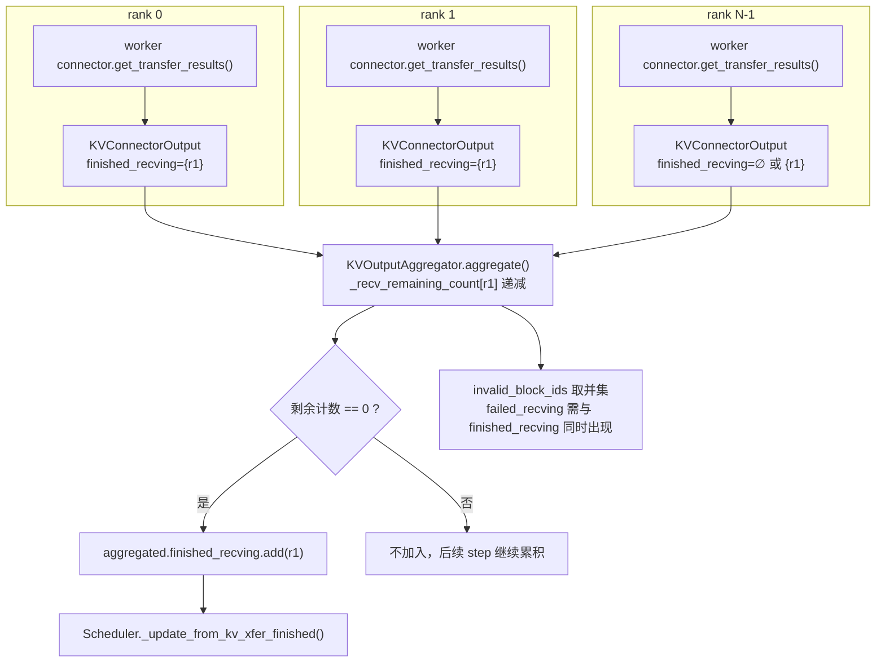

实现细节：

- 期望计数默认是 `world_size`（`executor/abstract.py:375-378`：`KVOutputAggregator.from_connector(connector, world_size)`），connector 可通过 `get_finished_count()` 覆盖（`base.py:750`）。
- 计数减到 0 才进 `finished_recving`，否则跨 step 保留在 `_recv_remaining_count`（`utils.py:90-102`）。
- `invalid_block_ids` 取并集；`failed_recving` 只有在同一 req 也出现在 `finished_recving` 时才视为最终失败（`utils.py:179-183`）。
- 统计/事件/worker meta 也在这里聚合，最终**覆盖写回指定 rank 的 `ModelRunnerOutput`**（`utils.py:186-200`），调度器只看到一份。

---

## 7. 调度器如何应用完成事件

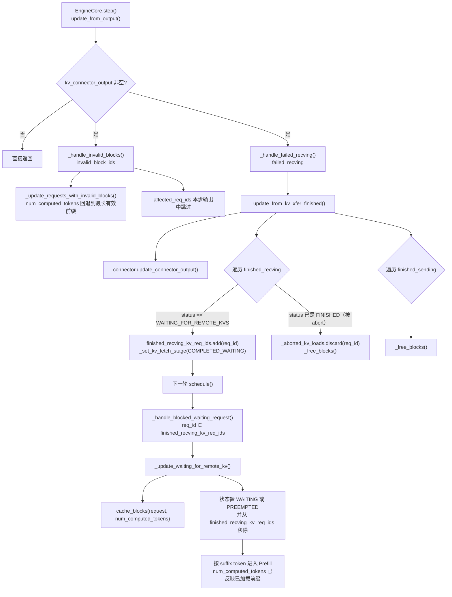

要点：

- **完成应用与状态迁移都在调度器主线程**，worker 线程只发布结果，不修改 `Request`（`scheduler.py:3706-3733`、`:3668-3685`）。
- **没有 load_id**：幂等靠 `Request.status` + `finished_recving_kv_req_ids`；重复/过期事件因状态已变而被忽略。
- 默认失败语义是**回退到最长有效前缀**继续重算，而不是整体 miss；只有布局无法按 block 定位时才走 `failed_recving` 整体放弃（`_handle_failed_recving()`，`scheduler.py:3839`）。

---

## 8. 取消与失败路径

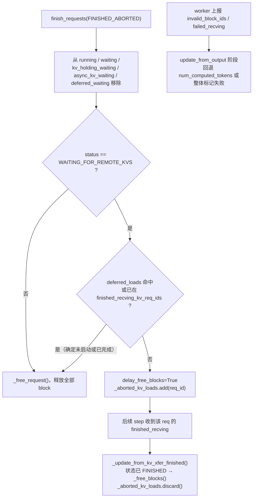

代码：`finish_requests()`（`scheduler.py:3100-3168`）、`_aborted_kv_loads`（`:517`、`:3166`、`:3728`）。

> `_aborted_kv_loads` 中的请求仍占用 inflight 额度，直到 completion 到达或底层明确结束（§4.3）。

---

## 9. MooncakeStoreConnector 的具体落点

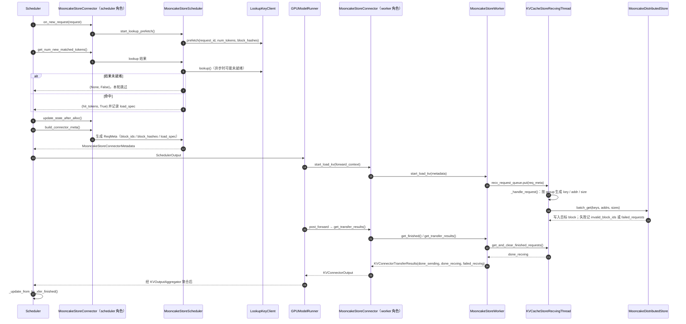

要点：

- **元数据内容**：`ReqMeta` 携带 `block_ids`（每 group 的目标 block）、`block_hashes`、`LoadSpec`（`vllm_cached_tokens` / `kvpool_cached_tokens` / `can_load` / `token_len` / `tail_key_boundaries`），worker 侧据此生成 Store key 与目标地址（`store/data.py:222`、`:275`）。
- **提交方式**：`MooncakeStoreWorker.start_load_kv()` 只做 `recv_request_queue.put(request)`，立即返回（`store/worker.py:2296-2314`）；`assert self.load_async`。
- **接收线程**：`num_recv_threads = max(1, VLLM_MOONCAKE_LOAD_RECV_THREADS)` 个 `KVCacheStoreRecvingThread` 共享队列（`:1675`、`:2254-2279`），`_handle_request()` 负责 key 生成、按 tp_rank 轮转均衡、`batch_get`、错误上报（`:1292` 起）。
- **结果收集**：`get_finished()` ∪ 各线程 `get_and_clear_finished_requests()`；失败与非法 block 分别来自 `get_and_clear_failed_requests()` / `get_and_clear_block_ids_with_load_errors()`（`:2338-2400`）。
- **Store 侧同步**：`post_forward()` 在收集结果前先 `wait_for_save()`（本次只关心 get，put 路径不影响该链路）。

### 9.1 `MooncakeStoreScheduler` 在 get / put 中做了什么

名字容易误解：它**不是 vLLM 的 `Scheduler`**，而是 connector 的 **scheduler 侧半边**，只在 `role == KVConnectorRole.SCHEDULER` 时实例化（`store/connector.py:215-220`），运行在 engine 进程里、**不持有 Store 句柄**，职责是「计划 + 元数据/引用管理」，不做 I/O、也不收集传输完成。

#### Get 路径（它负责出题，不负责收卷）

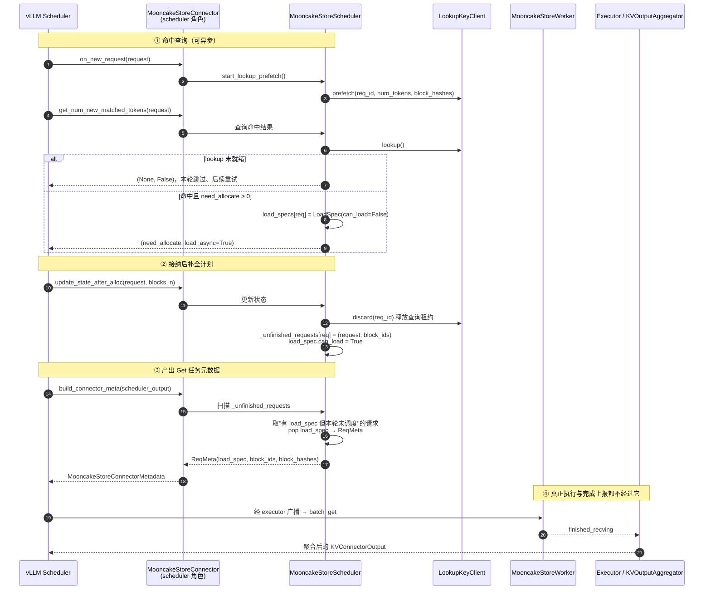

#### Put 路径（它负责保块与释放）

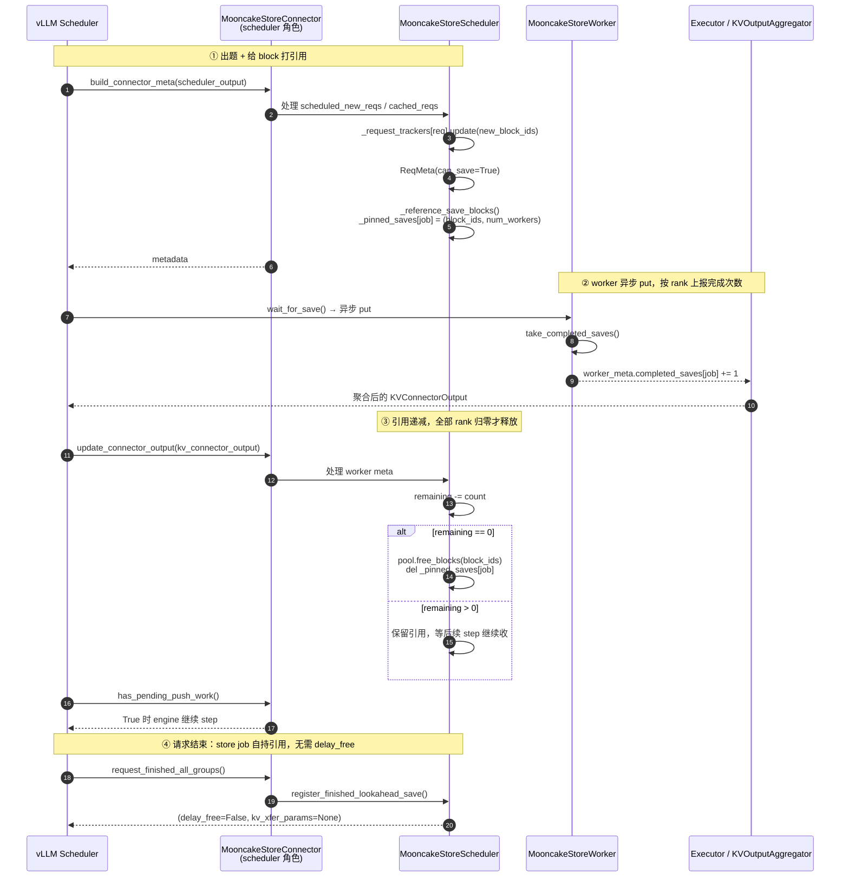

#### 内部状态总览

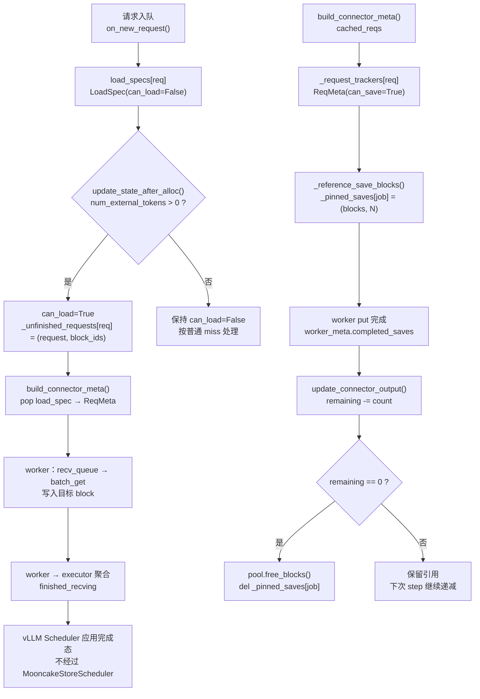

#### 方法速查

| 阶段 | 方法 | 作用 |
| --- | --- | --- |
| get 预热 | `start_lookup_prefetch()`（:215） | 请求一入队就异步 `prefetch` 命中查询，与等待调度重叠 |
| get 命中 | `get_num_new_matched_tokens()`（:230） | 取 lookup 结果；未就绪返回 `(None, False)`；命中则写 `LoadSpec(can_load=False)` |
| get 接纳 | `update_state_after_alloc()`（:282） | `discard` 掉 lookup lease，把 `(request, local_block_ids)` 记入 `_unfinished_requests`，校验 token 数后置 `can_load=True` |
| get 出题 | `build_connector_meta()`（:322，见 :447-480） | **真正的 Get 任务产出点**：扫描 `_unfinished_requests` 中「有 `load_spec` 但本轮不在 `scheduled_new_reqs`/`cached_reqs`」的请求（即被 vLLM Scheduler 放进 `WAITING_FOR_REMOTE_KVS` 的 load-only 请求），生成带 `load_spec` 的 `ReqMeta` |
| put 出题 | `build_connector_meta()`（见 :347-446） | 为 running/cached 请求按 `RequestTracker` 生成 `can_save=True` 的 `ReqMeta`（decode 受 `save_decode_cache` 控制） |
| put 保块 | `_reference_save_blocks()`（:530） | 每个 store job 打 GPU block 引用：`_pinned_saves[store_job_id] = (block_ids, num_workers)`，防止请求释放后 block 被复用 |
| put 收尾 | `update_connector_output()`（:754） | 消费 worker 上报的 `completed_saves`，按 `remaining -= count` 的**跨 rank ack 递减**，归零才 `pool.free_blocks()`；`has_pending_push_work()`（:778）让 engine 继续 step 直到所有 store job 释放引用 |
| 请求结束 | `request_finished_all_groups()`（`connector.py:292`） | 调 `register_finished_lookahead_save()`，返回 `(False, None)`——store job 自己持引用，无需 `delay_free` |
| 重置 | `reset_store()`（:788） | 经 LookupKey admin 通道让 worker rank0 执行全局 `remove_all` |

结论：**get 的"计划"和 put 的"block 生命周期"都由 `MooncakeStoreScheduler` 负责；真正的字节搬运与完成上报在 `MooncakeStoreWorker` + `KVCacheStoreRecvingThread`。** get 的完成路径不经过它——worker 上报 → executor 聚合 → vLLM `Scheduler`。

---

## 10. 与 REQ-KVP-04 设计的映射对照

| REQ-KVP-04 概念                     | vLLM 对应实现                                                                                         | 说明                                              |
| ----------------------------------- | ----------------------------------------------------------------------------------------------------- | ------------------------------------------------- |
| `waiting`                         | `waiting` + `async_kv_waiting`                                                                    | vLLM 把「有命中但未提交」的请求单独成队，便于限流 |
| `kv_loading`                      | `kv_holding_waiting` 中 `status == WAITING_FOR_REMOTE_KVS` 且不在 `finished_recving_kv_req_ids` | 已完成未调度的也在同一队列，用集合区分            |
| `kv_ready`                        | `kv_holding_waiting` 中 `request_id ∈ finished_recving_kv_req_ids`                               | 下一轮 `schedule()` 优先消费                    |
| `SchedulerOutputs.kv_load_tasks`  | `SchedulerOutput.kv_connector_metadata`（connector 自定义结构）                                     | 调度器只产出元数据                                |
| `post_schedule → start_load_kv`  | `KVConnector.pre_forward()` 绑定元数据，`post_forward()` 内 `_start_load_kv()`                  | 异步 load 实际提交在 forward 之后                 |
| `poll_completions()`（step 开头） | 无对应；完成随 `ModelRunnerOutput` 在 `update_from_output()` 落地                                 | DeepInfer 的 poll 属适配差异                      |
| `load_id` 幂等校验                | 无；靠 `Request.status` + `finished_recving_kv_req_ids`                                           | DeepInfer 增加 `load_id` 属增强                 |
| connector 内跨 rank 聚合            | `KVOutputAggregator`（executor 层，按 req 计数）                                                    | 位置不同，语义一致                                |
| 部分 block 失败 → 整体 miss        | `invalid_block_ids` → 回退最长有效前缀                                                             | vLLM 粒度更细；整体放弃仅限无法定位 block         |
| `aborted_kv_loads`                | `_aborted_kv_loads` + `delay_free_blocks`                                                         | 语义一致，且同样计入额度                          |
| `max_num_inflight_kv_loads`       | `scheduler_config.max_num_inflight_kv_loads` + `_admits_inflight_kv_load()`                       | 三项求和公式一致                                  |

---

## 11. 一句话总结

vLLM 的异步 KV Get 是**「调度器只出计划 → 各 rank worker 异步执行 → executor 统一计数聚合 → 同一步的 `update_from_output` 落地完成态 → 下一轮 `schedule()` 提升状态并做 suffix Prefill」**；聚合在 `KVOutputAggregator` 而非 connector，完成消费在 `update_from_output` 而非下一轮 step 开头。
